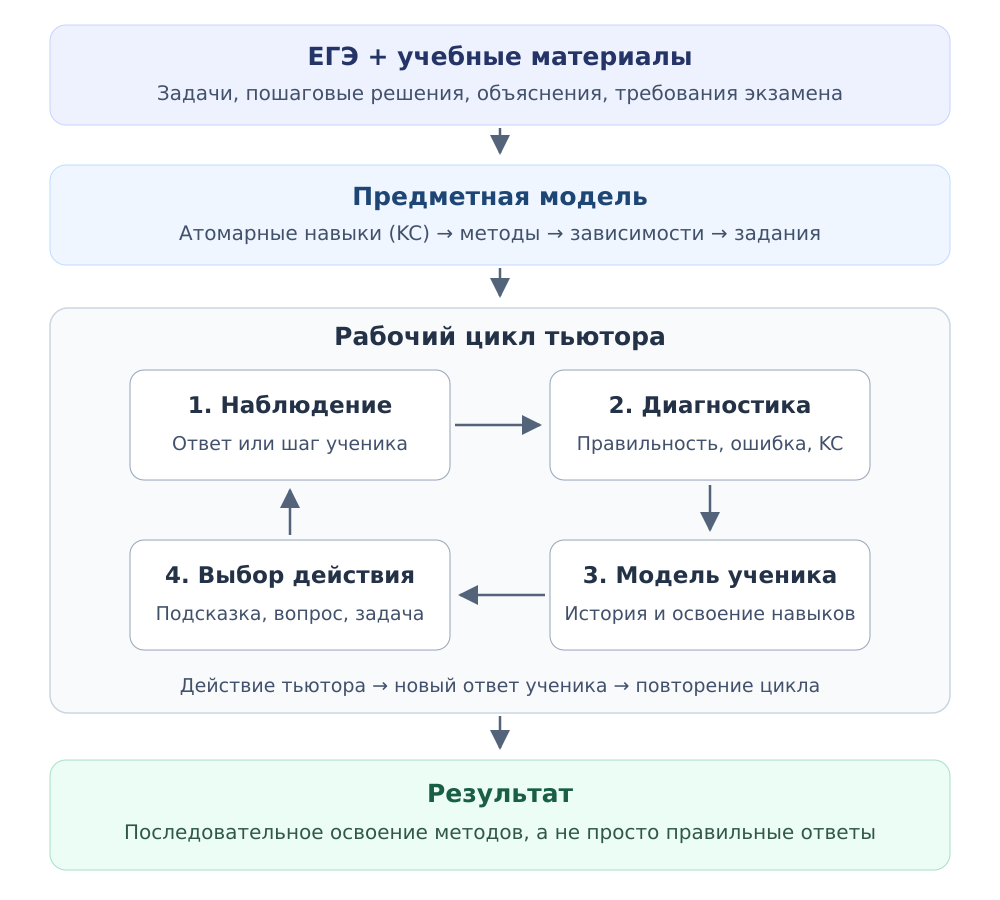

# Проактивная тьюторская система с использованием LLM и RAG

Годовой проект №65, 2026/27 учебный год.

## Проект за минуту

Делаем прототип тьютора для самостоятельной подготовки к профильному ЕГЭ по математике. Предметная область — вся программа профильного ЕГЭ по математике. Покрытие тем, типов задач и навыков анализируем по всему экзамену.

**Главная идея — тренировать методы решения через явные шаги ученика.** Задачи разбираем на действия и навыки; по попыткам ученика система должна определять затруднения, выбирать помощь и следующую практику. Цель — самостоятельное применение метода в новых задачах.

Например, неверный ответ при поиске производной может указывать на пропущенный множитель. Тьютор уточняет нужный шаг, помогает исправить его и предлагает другой пример для проверки навыка. Причина ошибки остаётся гипотезой до уточнения.

**Сейчас исследуем предметную модель:** собран снимок 1148 условий ФИПИ, подготовлены предварительные разборы 100 задач и анализ на Python. Частоты принятых связей KC рассчитаны по 98 задачам; каталог и математическая корректность всего корпуса требуют дальнейшей проверки.

**Пока открыты** детализация навыков, надёжность проверки и правила адаптации. Концепция и архитектура — рабочие версии для обсуждения с командой и куратором.

[Концепция системы](docs/project-vision.md) · [Текущий EDA-план](docs/eda/README.md)

Обновление 31 октября: собран банк ФИПИ и подготовлен [EDA-пилот 50 задач](data/annotation/runs/2026-10-31-fipi-50x1/README.md) с предварительными разборами, проверками между партиями и графиками. Есть [исполненный ноутбук](notebooks/EDA.ipynb); окончательная карта навыков и предметная экспертиза остаются открытыми.

## Навигация по проекту

- **[Чекпойнт 2: предварительный EDA.ipynb](notebooks/checkpoint-2/EDA.ipynb)** — единый анализ банка и 100 разборов, ограничения и решения для следующего этапа. [Практическая ценность, предварительный PDF на одну страницу](output/pdf/checkpoint-2-practical-value.pdf); [план и воспроизведение](docs/eda/05-analysis/checkpoint-2-plan.md). Дедлайн по переданному сообщению организаторов — 7 ноября, 23:59. Комплект от 4 ноября публикуется для обсуждения, исторические снимки сохранены. [Протокол следующего исследования связей данных](docs/eda/05-analysis/data-to-tutor-protocol.md) пока не исполнялся.

- [Продолжение ФИПИ командой](docs/eda/team-handoff.md) — готовые 100 задач, единая методика, реестр ID и порядок бронирования партий перед работой.

- [EDA-100: результат и ограничения](docs/eda/05-analysis/fipi-100-checkpoint.md) — расширение банка до 100 задач, независимый KC-аудит и проверенное офлайн-воспроизведение. Выполнено 3 ноября; дальнейшая работа остановлена по поручению пользователя.

- [EDA банка и пилота 50 задач](notebooks/EDA.ipynb) — воспроизводимые таблицы, графики и ограничения; [читаемый отчёт](data/annotation/runs/2026-10-31-fipi-50x1/derived/report.md).

- [Рабочее видение](docs/project-vision.md) — концепция системы, учебный цикл и текущий фокус.
- [План проекта](docs/project-plan.md) — этапы, сроки и проверка результата.
- [EDA-план](docs/eda/README.md) — подготовка предметной модели и анализ данных для чекпойнта 2.
- [Знакомство с ФИПИ](docs/eda/01-exam/fipi-overview.md) — обзор официальных документов, страницы для проверки и найденное расхождение.
- [Вопросы проектирования](docs/tutor-design-questions.md) — диагностика, профиль ученика и управление сессией.
- [Исследовательский обзор](research/deep-research-llm-based-its.md) — подходы к LLM-тьюторам и подборка источников.
- [Отложенные идеи](research/backlog/README.md) — внешние источники и проекты для возможного дальнейшего изучения.
- [Инструкции для AI-агентов](AGENTS.md) — как работать с репозиторием и обновлять документы.

## Основания проекта

ЕГЭ выбран как понятная, структурированная задача с доступными официальными материалами и критериями проверки. Для RAG подготовим отдельный корпус учебных объяснений с учётом условий использования источников. Для всех разделов экзамена собираем задачи и учебные материалы, готовим эталоны и анализируем покрытие навыков, чтобы измерять качество работы системы.

Основной фокус — инженерный: собрать работающий MVP и проверить качество его компонентов и учебных сценариев. Если появится возможность, постараемся провести добровольный пилот со школьниками и получить обратную связь.

## Команда

- [Vladislav Chumachenko](https://github.com/ThreeHundredsperSecond)
- [Bogdan Luckyanchuk](https://github.com/Bogdan108)
- [Salman Chakaev](https://github.com/srchakaev)
- [Alexander](https://github.com/ex-alander)

## Куратор

- [Фарид Мустафин](https://github.com/lanarich)

## План работы

| Этап | Срок | Планируемый результат |
|---|---|---|
| Старт и планирование | До 6 октября 2026 | Согласовать тему, цель, границы MVP и годовой план |
| Анализ данных и материалов | До 27 октября 2026* | Подготовить корпус, карту навыков и набор задач с эталонами |
| Базовое решение | До 27 ноября 2026* | Реализовать базовый RAG-тьютор и первые проверки качества |
| Сервис | До 15 декабря 2026* | Реализовать FastAPI-сервис со сквозной учебной сессией и сохранением истории |
| Промежуточная защита | 10–15 января 2027* | Показать прототип, результаты проверок и план второго семестра |
| Персонализация | До 15 марта 2027* | Добавить профиль ученика и адаптивный выбор помощи и заданий |
| Улучшение и сравнение | До 5 мая 2027* | Проверить варианты компонентов, реализовать проактивные предложения и сравнить с базовым решением |
| Финальные доработки | Май — начало июня 2027 | Обеспечить воспроизводимость, логирование, анализ ошибок и подготовить демонстрацию |
| Итоговая защита | 13–20 июня 2027* | Представить работающий MVP, результаты и ограничения |

\* Ориентировочные сроки из календаря программы. Содержание этапов адаптировано под тьюторскую систему и требует согласования с куратором.

На этапе EDA изучим покрытие навыков, типы задач и ответов, пробелы и дубли в корпусе, а также возможности автоматической проверки. Дальнейшие этапы и технические решения могут уточняться по результатам этой работы.

[Подробный план проекта](docs/project-plan.md): обоснование, задачи, сценарий MVP, проверка качества и открытые вопросы.

## Исследовательские материалы

Уже собраны [предварительный обзор и подборка статей о LLM-тьюторах](research/deep-research-llm-based-its.md). На следующем этапе используем их для анализа данных и материалов (EDA) и уточнения вариантов архитектуры. Текущий план — отправная точка для обсуждения, а не окончательная спецификация.
