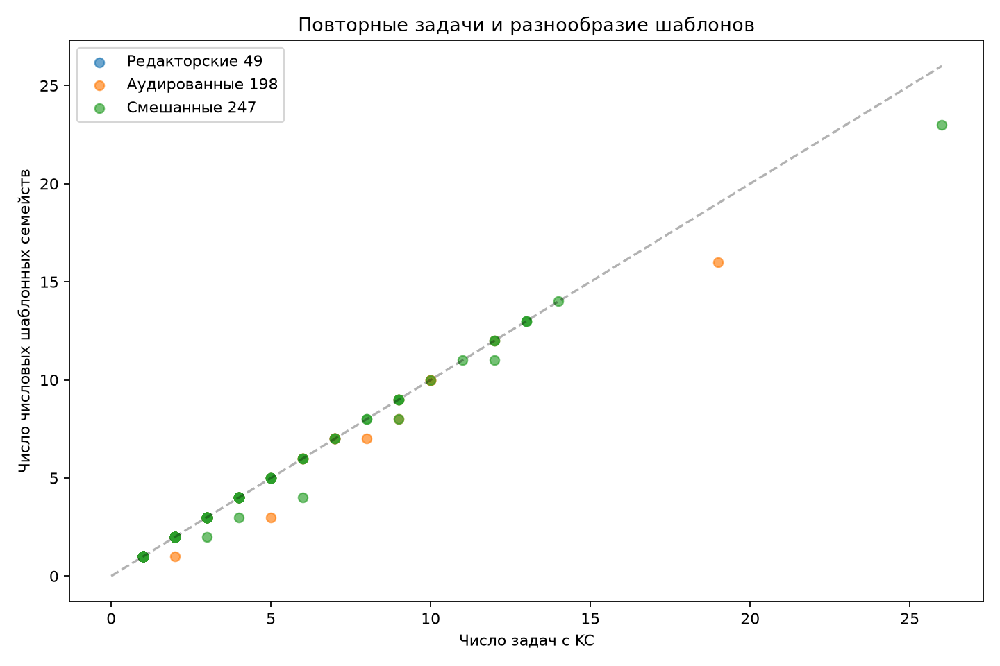
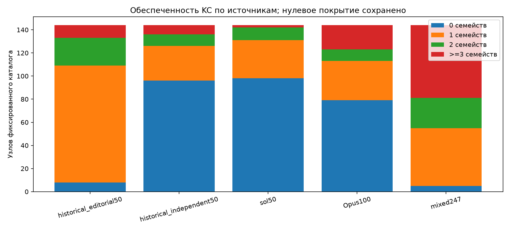

# Обеспеченность KC шаблонными семействами

Вопрос: сколькими разными числовыми шаблонами поддержано действие, уже сопоставленное фиксированному каталогу? Единица частоты — уникальная задача; семейство — SHA нормализованного DOM/MathML, instruction и SHA рисунков после маскирования числовых токенов. Один KC считается один раз на задачу и семейство.

Основная выборка: 247 из 250 сохранённых задач. Исходные политики дают 248; 321FCD с raw partial исключена общей политикой. Редакторские назначения и независимые аудиты разделены. Наблюдение KC означает предварительное сопоставление, а не внешнюю математическую валидацию.

| Слой | Задач | Семейств | KC: 0 | 1 | 2 | ≥3 | Задач с несопоставленными кандидатами |
|---|---:|---:|---:|---:|---:|---:|---:|
| mixed247 | 247 | 239 | 5 | 50 | 26 | 63 | 178 |
| audited198 | 198 | 191 | 58 | 26 | 22 | 38 | 178 |
| historical_editorial50 | 49 | 49 | 8 | 101 | 24 | 11 | 0 |
| historical_independent50 | 49 | 49 | 96 | 30 | 10 | 8 | 45 |
| sol50 | 50 | 48 | 98 | 33 | 11 | 2 | 44 |
| Opus100 | 99 | 98 | 79 | 34 | 10 | 21 | 89 |

## Повторы, видимые в сохранённых данных

| KC | Действие | Задач | Семейств | Задач в крупнейшем семействе |
|---|---|---:|---:|---:|
| linear_equation | Решать линейное уравнение с числовыми коэффициентами | 26 | 23 | 2 |
| literal_10490f2275e0 | Снимать квадратный корень равносильным возведением в квадрат | 6 | 4 | 2 |
| classical_probability | Вычислять вероятность по числу равновозможных исходов | 12 | 11 | 2 |
| literal_2443f08dda82 | Сводить равенство логарифмов к равенству аргументов | 3 | 2 | 2 |
| literal_7baedb55a81a | Устанавливать область определения логарифмического выражения | 9 | 8 | 2 |

В этой выборке повторов немного: 247 задач образуют 239 групп. Здесь нет наблюдения «10 задач в одном числовом шаблоне»; максимальные повторные группы в приведённых KC содержат две задачи. Основной наблюдаемый дефицит — малая поддержка многих KC, а не массовое дублирование.

linear_equation: пример повторного семейства 1FE24C, 4C69F7. Все ID приведены в CSV.

literal_10490f2275e0: пример повторного семейства 8C0C15, E1F91F. Все ID приведены в CSV.

classical_probability: пример повторного семейства 0F9157, 7FF06A. Все ID приведены в CSV.

literal_2443f08dda82: пример повторного семейства 586EF2, 91CD43. Все ID приведены в CSV.

literal_7baedb55a81a: пример повторного семейства 586EF2, 91CD43. Все ID приведены в CSV.

## Покрытие действий и ограничения

В Sol50 у 44 из 50 задач есть хотя бы один несопоставленный локальный кандидат. Полностью сопоставлены все KC лишь у 6 задач; 130 из 195 локальных кандидатов остаются вне сопоставления. По явным kc_ids шагов полностью сопоставлены 59 из 186 шагов. Это техническая полнота связи, а не оценка содержательной полноты действия.
В смешанных 247 полностью сопоставлены 418 из 913 шагов. Частоты семейств описывают только сопоставленную часть; новые кандидаты не сливаются с каталогом.

Разные семейства не означают независимые методы или разные когнитивные действия. Маскирование чисел может объединить задачи с разными математическими случаями; разные формулировки и рисунки могут разделить один метод. SHA рисунков сохраняется в ключе: даже близкие изображения остаются разными группами. Без предметной проверки число семейств не является числом независимых упражнений.

Для будущего тьютора KC с одной-двумя группами — кандидаты на проверку разнообразия условий и поиск других шаблонов в сохранённом банке. Высокая частота задач при повторении группы обосновывает проверку дефицита переноса, но не доказывает его. Даже ≥3 семейства не гарантируют пригодность упражнений. Нужны предметная проверка групп и проверенные решения; данные не измеряют освоение ученика, трудность или эффект подсказок.

Полные частоты, ID задач/семейств и крупные разделы КЭС находятся в kc-family-frequency.csv; связи — в kc-task-family-links.csv; полнота сопоставления и происхождение — в tasks.csv. КЭС — метка источника, не KC. Скрипт запускается из корня: `.venv/Scripts/python.exe scripts/fipi_kc_family_coverage.py report`; `smoke` повторяет инварианты без записи.
