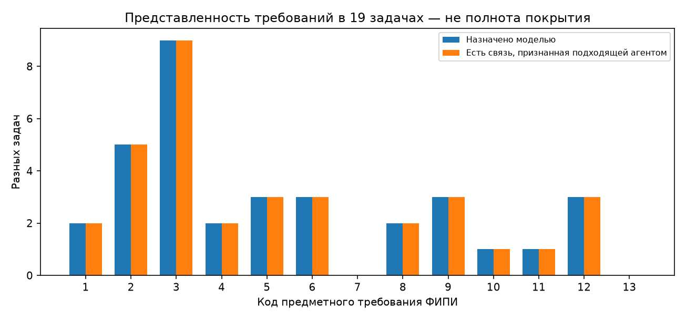
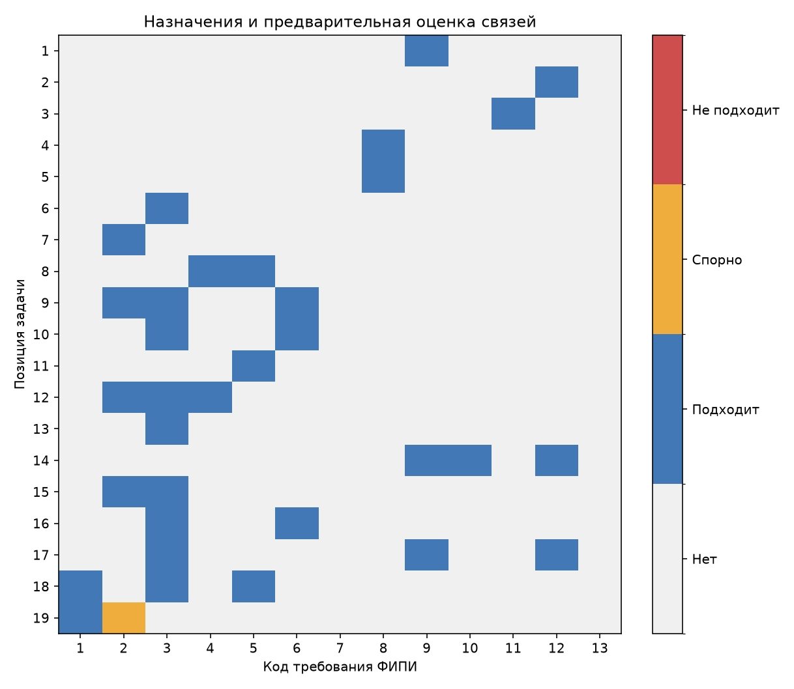
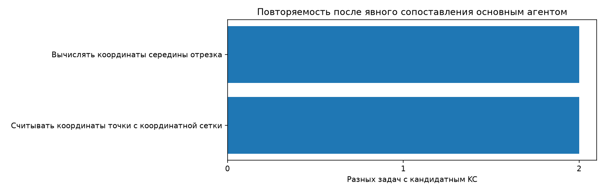

# A-FIPI-v1: обзор 19 задач

19 новых ответов, один на задачу; все исходные данные и оценки доступны по ссылкам ниже. Статусы — предварительная оценка основного агента, не экспертный эталон.

## Summary

- Получено: 19/19; технически валидных: 19/19.
- KC: 81 исходных упоминаний → 79 кандидатных определений после явного сопоставления; в нескольких задачах: 2.
- Связей с ФИПИ: 55; оценки: {'plausible': 54, 'questionable': 1}.
- Назначений шаг → KC: 90; оценки: {'supported': 89, 'questionable': 1}.
- Представлены назначениями 11 из 13 широких требований. Это не процент покрытия программы.
- Предварительная проверка решений: {'no_obvious_error': 19}. Стабильность не измерялась.

**На этом наборе схема сверху вниз дала проверяемую классификацию действий по официальной рамке. Единую детализацию и готовую диагностическую карту она пока не дала.**

Назначения представлены в 11 из 13 требований; не назначены коды 7 и 13. Это не означает покрытие 11/13 программы: требование 7 о статистике может отсутствовать из-за состава задач, а общий выбор метода (13) может не выделяться самостоятельным KC. Модель ни разу не выбрала неопределённость, однако один пример связи оценён спорным — отсутствие UNKNOWN не доказывает отсутствие проблем классификации.

Что получилось:

- №8 разделяет чтение графика (требование 5) и применение производной (4); №10 — модель смеси (6) и алгебру (3); №14 — планиметрию (9), построение сечения (10), координатный расчёт (12). Видно, на каком основании задача относится к нескольким классам.
- У каждого назначенного класса есть точная цитата и объяснение модели. Это позволяет проверять связи и обсуждать ошибки, сохраняя происхождение.
- При консервативном просмотре найдены общие кандидатные операции: чтение координат в №2/№11 и середина отрезка в №14/№17. Для чтения координат сохранено отличие более узкого контекста графика. Другие составные определения не объединялись ради повторяемости.

Проблемы и конкретные переходы:

- **№18, s4 → k2:** KC описывает подстановку фиксированной переменной, а в шаге фиксируется параметр и вводится модуль. Назначение помечено спорным. Это проблема соответствия «шаг — KC», а не найденная математическая ошибка.
- **№19, вторая связь ФИПИ:** десятичные переносы, оценка и перебор объединены под цитатой «знакомство с различными позиционными системами счисления». Общая связь понятна, но цитата слишком широка для всей группы действий. Требуется уточнение, а не автоматическое признание верной по совпадению слов.
- **№3:** формулы объёмов размечены, но установление отношения и вычисление по нему отдельно не представлены KC. **№16:** условие общей суммы выплат превращается в уравнение, тогда как назначенный KC описывает исключение неизвестной. Эти два возможных пропуска зависят от принятой детализации и сохранены явно.
- Составность осталась: например, №7:k2 включает тождество и извлечение корня, №12:k3 — знаменатель, квадратное уравнение и отбор; №15:k4 — общую дробь и факторизацию. ФИПИ фиксирует класс, но не выбирает эти границы за нас.

Основной агент просмотрел все рассуждения и отдельно сравнил итоги с сохранёнными ответами источника; явных математических ошибок не обнаружил. Это предварительная проверка, не независимый эталон. Перечни минимальных чисел в №19 дополнительно сверены исчерпывающим локальным перебором (math-check.json), что проверяет только эту часть доказательства.

**Следующий ограниченный шаг:** обсудить две спорные связи и два возможных пропуска, затем зафиксировать правила выбора уровня KC. Не расширять генерацию и не переписывать промпт автоматически. Уменьшение числа сомнений после ручной правки не будет самостоятельным доказательством улучшения модели.

## Графики

## Навигация по задачам

| № | Классы модели | Математический просмотр | Содержательные замечания | Материалы |
|---|---|---|---|---|
| 1 | 9 | no_obvious_error | Два конкретных KC внутри широкого требования 9. | [Карточка](review.html#task-1) · [raw](../raw/699085.txt) · [запрос](../requests/699085.txt) |
| 2 | 12 | no_obvious_error | Разделены чтение координат и вычисление вектора; все KC относятся к 12. | [Карточка](review.html#task-2) · [raw](../raw/699086.txt) · [запрос](../requests/699086.txt) |
| 3 | 11 | no_obvious_error | В одном Step собраны формулы, отношение и вычисление. Для последних двух действий отдельного KC нет. | [Карточка](review.html#task-3) · [raw](../raw/699087.txt) · [запрос](../requests/699087.txt) |
| 4 | 8 | no_obvious_error | Распознавание несовместности и объединения событий включены в один KC. | [Карточка](review.html#task-4) · [raw](../raw/699088.txt) · [запрос](../requests/699088.txt) |
| 5 | 8 | no_obvious_error | KC сочетаний сформулирован для общего числа выбираемых объектов, применён только выбор двух. | [Карточка](review.html#task-5) · [raw](../raw/699089.txt) · [запрос](../requests/699089.txt) |
| 6 | 3 | no_obvious_error | Равносильное решение без отдельной подстановки; это не ошибка. | [Карточка](review.html#task-6) · [raw](../raw/699090.txt) · [запрос](../requests/699090.txt) |
| 7 | 2 | no_obvious_error | Нахождение квадрата синуса и извлечение корня объединены в k2. | [Карточка](review.html#task-7) · [raw](../raw/699091.txt) · [запрос](../requests/699091.txt) |
| 8 | 4, 5 | no_obvious_error | k2 включает максимум, исключение монотонных участков и отбор: классификация ясна, детализация составная. | [Карточка](review.html#task-8) · [raw](../raw/699092.txt) · [запрос](../requests/699092.txt) |
| 9 | 6, 2, 3 | no_obvious_error | k1 объединяет подстановку, выражение степени и смысловое ограничение; k3 также включает отбор. | [Карточка](review.html#task-9) · [raw](../raw/699093.txt) · [запрос](../requests/699093.txt) |
| 10 | 6, 3 | no_obvious_error | k5 объединяет алгебру и допустимость модели; с простым линейным KC №6 целиком не объединён. | [Карточка](review.html#task-10) · [raw](../raw/699094.txt) · [запрос](../requests/699094.txt) |
| 11 | 5 | no_obvious_error | Чтение координат связано с №2 на уровне применённой операции; исходное определение ограничено графиком функции. | [Карточка](review.html#task-11) · [raw](../raw/699095.txt) · [запрос](../requests/699095.txt) |
| 12 | 2, 3, 4 | no_obvious_error | k3 объединяет устранение знаменателя, квадратное уравнение и отбор; эти границы ФИПИ не уточняет. | [Карточка](review.html#task-12) · [raw](../raw/699096.txt) · [запрос](../requests/699096.txt) |
| 13 | 3 | no_obvious_error | k1 объединяет понижение степени и приведение; класс 3 выбран для всех четырёх KC. | [Карточка](review.html#task-13) · [raw](../raw/699097.txt) · [запрос](../requests/699097.txt) |
| 14 | 9, 10, 12 | no_obvious_error | Планиметрия, построение сечения и координатный расчёт разделены между требованиями 9,10,12. | [Карточка](review.html#task-14) · [raw](../raw/699098.txt) · [запрос](../requests/699098.txt) |
| 15 | 2, 3 | no_obvious_error | k4 включает общую дробь и факторизацию; оба действия выполнены, но граница составная. | [Карточка](review.html#task-15) · [raw](../raw/699099.txt) · [запрос](../requests/699099.txt) |
| 16 | 6, 3 | no_obvious_error | k5 объединяет ставку и проверку всей модели; условие общей суммы выплат используется без отдельного KC. | [Карточка](review.html#task-16) · [raw](../raw/699100.txt) · [запрос](../requests/699100.txt) |
| 17 | 12, 3, 9 | no_obvious_error | Середина отрезка повторяет KC №14; пересечение прямых включает проверку принадлежности. | [Карточка](review.html#task-17) · [raw](../raw/699101.txt) · [запрос](../requests/699101.txt) |
| 18 | 1, 3, 5 | no_obvious_error | Привязки к классам подходят; назначение k2 шагу s4 спорно: там фиксируется параметр и вводится модуль, а не фиксированная переменная системы. | [Карточка](review.html#task-18) · [raw](../raw/699102.txt) · [запрос](../requests/699102.txt) |
| 19 | 1, 2 | no_obvious_error | Связь k2/k4/k7 с фразой «знакомство с различными позиционными системами счисления» спорна; математика отдельно просмотрена. | [Карточка](review.html#task-19) · [raw](../raw/699103.txt) · [запрос](../requests/699103.txt) |

## Пересчёт и пределы выводов

Из корня: `python scripts/fipi_annotation_run.py capture`, затем `python scripts/analyze_fipi_run.py`. Модель/сеть не вызываются. Смысловые входы — `../reviews.json` и `../interpretation.md`; численные таблицы CSV находятся рядом с отчётом. SHA-256 кода, ответов, оценок, таблиц, отчётов и графиков — `provenance.json`.

Количество кандидатов зависит от консервативных решений о границах KC. Изменение числа KC не является автоматически улучшением; объединения по широким темам не выполнялись. Направление связи с ФИПИ выбирала модель; смысл проверял основной агент. Переиспользование кандидатных действий не доказывает перенос навыка у ученика. Все 19 задач — известный набор разработки. Полнота программы, устойчивость повторов и эффективность тьютора не проверены.
