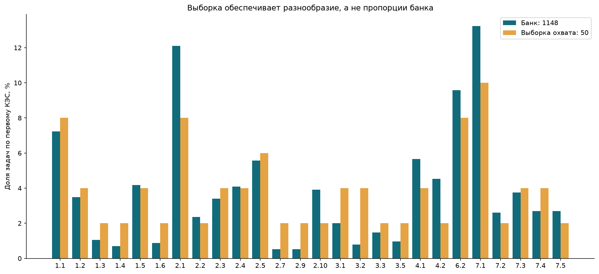
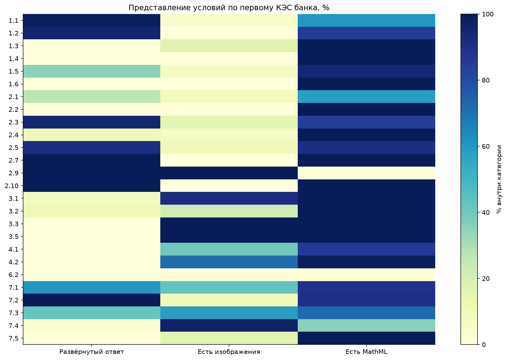
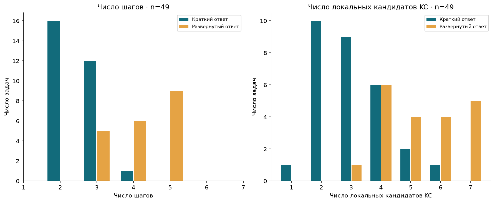
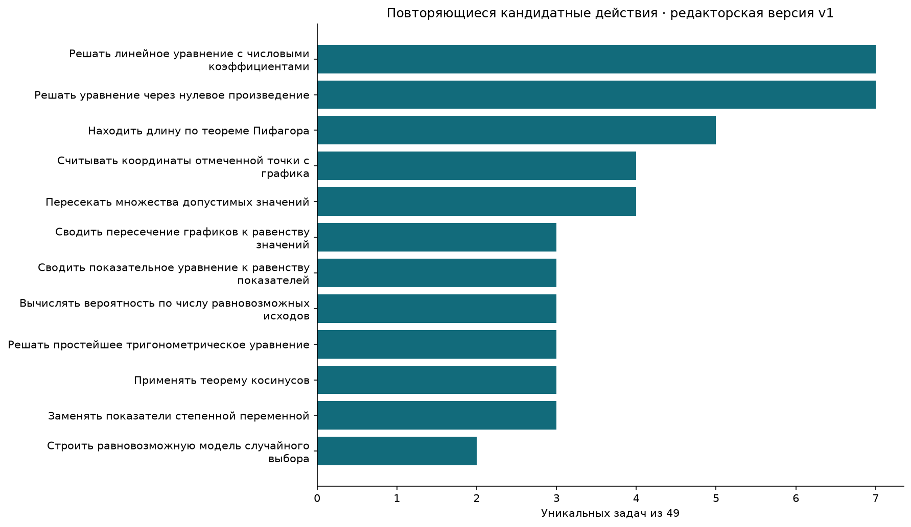
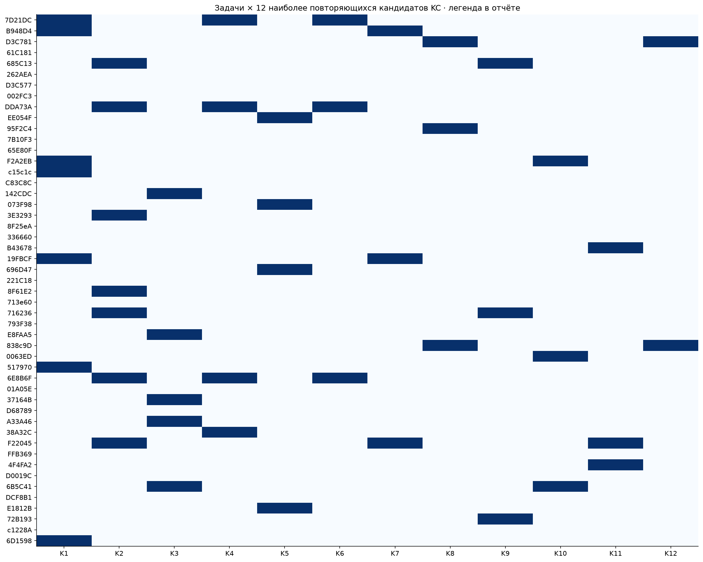
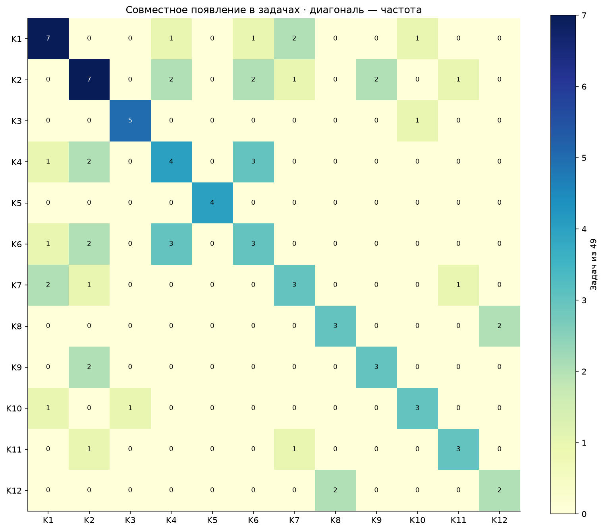

# EDA ФИПИ: банк условий и пилот 50 задач

31 октября 2026. [Карточки, каталог и графики](index.html) · [Протокол до разбора](../PROTOCOL.md).

## Что исследовали и как

По всему банку Python обработал 1148 условий без передачи банка модели. Отдельно основной ассистент в одном общем контексте подготовил 50 новых самостоятельных разборов по одному на задачу. Первые два просмотрены до продолжения, затем шесть партий по восемь с [health checks](../checks/). Изолированных запусков, платного API и независимых повторов нет. `requests/` — зафиксированные инструкции и входы, не журнал API. Это предварительная разметка для разработки, не внешний эталон.

Выборка покрывает все 38 непустых страт «первый КЭС × тип ответа»: 29 кратких и 21 развёрнутая. Она специально перепредставляет редкие категории, поэтому частоты навыков ниже относятся только к ней. График 01 показывает отличие её долей от банка. Один ранее подтверждённый дефект символа `697AC9` заранее исключён из отбора; это не то же замечание, что неоднозначность геометрии ниже.

## 1. Какие материалы есть в банке

- Краткий ответ: 673/1148 (58,6%); развёрнутый: 475/1148 (41,4%). Ответов и решений источник этим сбором не предоставил.
- Изображения есть у 286/1148 (24.9%); MathML — у 859/1148 (74.8%). Эти группы пересекаются. Изображения включают не только геометрию/графики, но и формулы.
- У задач 26 разных первых кодов КЭС и 29 кодов среди всех меток. Всего 1707 назначений КЭС на 1148 задач: многометочные частоты не должны суммироваться в 100%.
- Самые большие категории по первому КЭС: 7.1 — 152, 2.1 — 139, 6.2 — 110, 1.1 — 83, 4.1 — 65. Это частоты открытого банка, не распределение заданий реального экзамена.
- Соответствие кодов банка кодификатору конкретного года не сверено. Отсутствие категории среди первых меток не означает отсутствие её задач или пробел официальной программы. Официальное покрытие всей программы этой таблицей не установлено.

**Для тьютора:** вход должен сохранять смешанное представление текста, MathML и изображений; одного извлечённого текста недостаточно. Баланс практики нельзя выбирать только по частотам банка.

## 2. Повторы условий

По строгому ключу «нормализованный DOM и текст условия + инструкция + SHA-256 содержимого изображений» найдено 0 групп точных совпадений. Это не доказательство отсутствия смысловых дублей.

После маскирования чисел найдено 90 групп **кандидатных числовых шаблонов**; все ID сохранены в [реестре](duplicate-groups.json). Картинки при этом не маскируются, а сравниваются по содержимому. Эти группы не объявлены одинаковыми методами и не удалены. Перед разделением разработки/проверки нужно просматривать похожие семейства, чтобы близкие варианты не дали завышенное качество переноса.

## 3. Что получилось при разборе 50 задач

Все 50 JSON технически валидны. Сохранены 162 шагов и 204 локальных кандидата KC. Предварительный просмотр оставил 49 `solved` и один `partial`; это **не accuracy 98%**: официального ключа, независимого оценщика и ослепления нет.

Неоднозначность — [eFF32e](cards/eFF32e.html). При обычном внутреннем пересечении ребра получено SK:KA=1:2. Если разрешить K=S, построена конфигурация с равносторонним вертикальным сечением нужной площади, в которой пункт а) не выполняется. Это требует уточнения принятой геометрической интерпретации; не утверждаем, что доказана ошибка официальной задачи. Исходный разбор не исправлялся молча. Эта задача исключена из основных частот; ниже n=49 (29 кратких, 20 развёрнутых).

| Показатель | Краткий ответ, n=29 | Развёрнутый, n=20 |
|---|---:|---:|
| Медиана шагов | 2 | 4.0 |
| Диапазон шагов | 2–4 | 3–5 |
| Медиана локальных KC | 3 | 5.0 |
| Диапазон локальных KC | 1–6 | 3–7 |

**Для тьютора:** в этой выборке развёрнутые задачи требуют более длинной наблюдаемой цепочки. Однако число шагов зависит от принятой детализации и не является калиброванной трудностью. Число Method означает использованные маршруты/части, а не число всех возможных способов решения.

## 4. Какие действия повторяются

Отдельный [редакторский вход](../catalog-decisions.json) содержит определения, все соответствия и цитаты шагов. Явно заданные группы операций объединены основным ассистентом после просмотра ответов; вне этих групп объединяются только буквально одинаковые название и описание. Это не автоматическое смысловое распознавание и не внешняя экспертиза. Старые каталоги не менялись.

По включённым 49 задачам: 177 различных буквальных пар «название + описание» и 136 узлов редакторской версии v1. Всего для всех 50 — 144 узла, включая частичный разбор. Разница показывает зависимость результата от решения о сопоставлении, а не доказанное улучшение.

| Метка графиков | Кандидатное действие | Задач |
|---|---|---:|
| K1 | Решать линейное уравнение с числовыми коэффициентами | 7 / 49 |
| K2 | Решать уравнение через нулевое произведение | 7 / 49 |
| K3 | Находить длину по теореме Пифагора | 5 / 49 |
| K4 | Считывать координаты отмеченной точки с графика | 4 / 49 |
| K5 | Пересекать множества допустимых значений | 4 / 49 |
| K6 | Сводить пересечение графиков к равенству значений | 3 / 49 |
| K7 | Сводить показательное уравнение к равенству показателей | 3 / 49 |
| K8 | Вычислять вероятность по числу равновозможных исходов | 3 / 49 |
| K9 | Решать простейшее тригонометрическое уравнение | 3 / 49 |
| K10 | Применять теорему косинусов | 3 / 49 |
| K11 | Заменять показатели степенной переменной | 3 / 49 |
| K12 | Строить равновозможную модель случайного выбора | 2 / 49 |

Линейное уравнение встретилось в семи задачах: графики прямых `7D21DC`, показательные `B948D4`/`19FBCF`, геометрия `F2A2EB`, физическая формула `c15c1c`, логарифм `517970` и проценты `6D1598`. Оно не дробилось на отдельные переносы и деление. Это конкретный кандидат для подбора практики одного действия в разных контекстах; успех ученика на одном контексте ещё не доказывает перенос.

Чтение координат, восстановление функции и решение уравнения пересечения сохранены раздельно (`7D21DC`, `DDA73A`, `6E8B6F`). По ошибке ученика тьютор мог бы уточнять разные этапы, но такое диагностическое различение пока не проверено на попытках учеников.

У 101 из 136 узлов (74.3%) только одно применение. Причины могут сочетать широкий отбор, малое число примеров каждого типа и несогласованную детализацию; нельзя объявлять все единичные узлы лишними или все повторения доказанными навыками. Следующее полезное действие — просмотр определений и контрпримеров, а не автоматическое сжатие каталога.

## 5. Сочетания и наблюдаемый порядок

В клетке — число задач с обоими узлами, диагональ — число задач с узлом. Легенда K1–K12 приведена выше и в [CSV](cooccurrence-legend.csv). Все пары — в [CSV](kc-cooccurrence.csv).

Переход считается только между соседними шагами **внутри записанного Method**, без искусственного соединения независимых пунктов. Несколько KC внутри одного шага не упорядочиваются. Частота — число задач, где переход встречается хотя бы в одном маршруте; повтор в той же задаче не увеличивает частоту.

| Наблюдаемый переход | Задач |
|---|---:|
| Сводить показательное уравнение к равенству показателей → Решать линейное уравнение с числовыми коэффициентами | 2 |
| Строить равновозможную модель случайного выбора → Вычислять вероятность по числу равновозможных исходов | 2 |
| Решать простейшее тригонометрическое уравнение → Отбирать периодические корни на заданном промежутке | 2 |
| Восстанавливать прямую пропорциональность по точке → Сводить пересечение графиков к равенству значений | 2 |
| Восстанавливать прямую пропорциональность по точке → Решать уравнение через нулевое произведение | 2 |
| Считывать координаты отмеченной точки с графика → Восстанавливать прямую пропорциональность по точке | 2 |
| Находить стационарные точки по нулю производной → Находить глобальный экстремум на отрезке | 2 |
| Считывать координаты отмеченной точки с графика → Восстанавливать линейную функцию по двум точкам | 1 |

Полный [реестр переходов](kc-transitions.csv). Совместное появление и направление в решении не доказывают prerequisites, эффективность обучения или единственный допустимый метод.

## Что теперь можно показать и что проверять дальше

Есть весь банк условий, 50 читаемых разборов, шесть графиков, матрицы, явные определения и один разобранный спорный случай. Пилот показывает конкретные повторения действий между категориями и ограничения входных представлений. Он не устанавливает окончательную карту KC, устойчивость промпта, корректность всех решений или освоение ученика.

Дальше: просмотреть `eFF32e`, определения популярных узлов и несколько единичных кандидатов; затем выбрать новые подтверждения/контрпримеры и отделить проверочную выборку. Новый пакет, повторы и весь банк автоматически не запускаются. Все материалы локальные; commit/push и PDF не выполнялись.

Пересчёт без модели: `.venv/Scripts/python.exe -B -X utf8 scripts/analyze_fipi50.py`.
Ноутбук: `notebooks/EDA.ipynb`. Входы и код связаны SHA-256 в [provenance](provenance.json).
