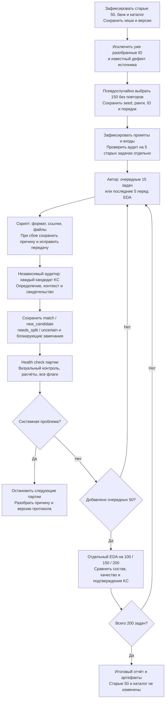

# Расширение ФИПИ с 50 до 200 задач: протокол v1

Дата: 2 ноября 2026. Статус: методика перед стартом; отбор и новые агентные запуски ещё не выполнены. Рабочая ветка — `docs/full-ege-math-scope`.

## Цель и границы

Добавить 150 ранее не разобранных задач к сохранённым 50. Проверить, как меняются состав выборки, структура решений и повторяемость действий. После каждых 50 новых задач делать EDA накопленного корпуса: 100, 150, 200 задач. Это исследование предметной модели, не оценка освоения ученика и не доказательство качества тьютора.

Исходные [50 разборов](../../../data/annotation/runs/2026-10-31-fipi-50x1/README.md), их raw, промпт, редакторский каталог, оценки, графики и [ноутбук](../../../notebooks/EDA.ipynb) не менять и не пересчитывать поверх старых файлов. Включая partial `eFF32e`: не исправлять её в рамках расширения. Исходный банк также не пересобирать.

Все пути будущих артефактов ниже — спецификация, а не свидетельство их существования. Текущая работа сохраняет только этот протокол, [промпт аудитора](12-kc-auditor-prompt.md) и навигацию. Запуск — отдельное действие после просмотра.

## 1. Что фиксируем до первого нового решения

В отдельной папке нового запуска `data/annotation/runs/<дата>-fipi-extension-150/` сохраняем:

| Артефакт | Для чего |
|---|---|
| `PROTOCOL.md` и `environment.json` | Буквальная версия методики, git commit, версии Python/пакетов и команды |
| `baseline-manifest.json` | SHA-256 всех файлов исходного пилота, банка, старого ноутбука и используемых скриптов; перечень 50 ID |
| `catalog-v1.json` | Замороженная копия 144 предварительных узлов `catalog-decisions.json`; происхождение и SHA-256 |
| `catalog-for-auditor.json` | Только ID, названия, определения и оговорки узлов; без прежних назначений, частот и членов групп |
| `author-prompt.txt`, `auditor-prompt.txt` | Полные буквальные инструкции, версии и SHA-256 |
| `eligible.json`, `exclusions.json`, `selection.json` | Допустимый пул, исключения, выбранные 150 ID, порядок, seed и ранги |
| `coverage-before.csv` | Состав банка, исходных 50 и отобранных 150 до генерации |
| `inputs/`, `requests/` | Точные условия, изображения и полностью развёрнутые задания агентов |

Автору передаём сохранённый `EDA-50-v1` без изменения математических правил и формата JSON. Фразу про последующую редакторскую операцию поясняем отдельной обвязкой: сопоставление выполняет независимый аудитор; автор не получает каталог и не выбирает его ID. Обвязка тоже сохраняется. Это новая организация запуска, поэтому изменения результатов нельзя приписывать только увеличению выборки.

## 2. Как выбираем ещё 150: случайно и без повторов

1. Прочитать 1148 записей локального `tasks.jsonl`; проверить уникальность ID и хеш снимка.
2. Исключить все 50 ID исходного пилота. Останется 1098 задач.
3. До выбора исключить задачи с уже зафиксированными `source_issues`; записать ID и причину. В текущем снимке это `697AC9`, ожидаемый допустимый пул — 1097. Новых исключений по увиденной сложности или результату решения не делать.
4. До отбора опубликовать seed `fipi-extension-150-v1-2026-11-02`. Для каждого ID вычислить `SHA256(UTF8(seed + "|" + id))`. Сортировать по паре `(hex_digest, id)`, регистр ID сохранять как в источнике. Взять первые 150. Это воспроизводимый псевдослучайный отбор без возвращения и без тематических квот; криптографическая случайность не требуется.
5. Сохранить ранги всего допустимого пула, выбранные ID и порядок. Отбор не перезапускать ради более красивых долей. Близкие шаблоны только помечать, не подменять ими выбранные задачи.
6. Построить таблицу состава: все метки КЭС отдельно от первой, формат ответа, изображения, MathML, группы близких шаблонов. Она показывает фактический охват, не управляет заменами после отбора.

150 новых задач случайны относительно допустимого остатка. Совокупность 200 включает старую выборку охвата, поэтому автоматически репрезентативной для банка не становится. Частоты всего корпуса описательные, без заявления о частотах реального экзамена. Математически неоднозначные или не решённые новые задачи остаются среди отобранных и входят в отчёт качества; их не заменяем лёгкими.

## 3. Партии и контрольные точки

| Блок новых задач | Партии | После блока |
|---|---|---|
| 1–50 | 15 + 15 + 15 + 5 | EDA-100: исходные 50 + новые 50 |
| 51–100 | 15 + 15 + 15 + 5 | EDA-150: исходные 50 + новые 100 |
| 101–150 | 15 + 15 + 15 + 5 | EDA-200: исходные 50 + новые 150 |

Партия содержит не более 15 задач. Последняя партия каждого блока — 5, чтобы не перескакивать контрольную точку. Новые задачи генерируются один раз, без трёх повторов. Приостановка не меняет уже выбранную очередь.

## 4. Кто что делает в каждой партии

**Оркестратор** подготавливает точные входы, запускает агентов, сохраняет ответы и выполняет проверки формата. Не решает за аудитора, какие KC объединять.

**Агент-автор** получает одну задачу и её изображения в новом контексте без каталога, старых решений и разметок. Самостоятельно решает, сохраняет ответ, шаги, входные ссылки, методы и локальные KC. Одно задание на контекст; исходный ответ неизменяем. Авторские ответы — предварительные решения, не официальные ответы ФИПИ.

**Скрипт** проверяет комплектность входов и ответов, JSON, уникальность ID, ссылки шаг→KC и метод→шаг, отсутствие циклов/ссылок вперёд во входном состоянии, локальные изображения и хеши. Технический сбой не означает смысловой отказ: его устраняем, сохраняя исходный файл и журнал. Без полного читаемого входа аудит не запускаем.

**Агент-аудитор** получает одну задачу, весь её авторский разбор, изображения и полный замороженный каталог. Новый контекст, без истории автора, прежних редакторских соответствий, частот и ожидаемых ответов. Сам ищет соответствия, фиксирует свидетельства и причины. Каталог — проверяемая гипотеза, не внешний эталон. Основной ассистент его решения вручную не подменяет.

На каждый локальный KC аудитор возвращает ровно один статус:

- `match`: определение целиком соответствует наблюдаемому действию; ID, свидетельства и обоснование обязательны.
- `new_candidate`: проверены близкие определения, подходящего нет; новый узел только предложен.
- `needs_split`: кандидат смешивает действия; перечислены части, без автоматической переписи raw.
- `uncertain`: контекст, граница определения или качество решения не позволяют надёжно сопоставить.

Аудитор также отмечает явные математические проблемы и действия, пропущенные авторской разметкой. Это дополнительный просмотр, не независимое полное решение и не экспертная валидация. `match` с блокирующей проблемой не допускается в основные частоты.

## 5. Что означает health check после каждой партии

Сохраняем `checks/batch-NN.json` и читаемую сводку:

1. **100% технический контроль:** количество выбранных задач, авторских ответов и аудитов совпадает; каждому кандидату соответствует одна запись аудита; ID каталога существуют; хеши исходных 50 не изменились.
2. **Контроль представления:** автоматически проверить все изображения и отрисовать все новые карточки. Визуально просмотреть минимум три по заранее определённым правилам: первая задача партии; первая с изображением, если есть; первая с MathML, если есть. Совпавшие ID дополнить следующими по очереди до трёх (или размера партии). Все замеченные дефекты просмотра — в журнал.
3. **Предметный просмотр:** аудитор рассматривает все задачи на достаточность свидетельств и блокирующие ошибки. Для этих же трёх контрольных задач оркестратор дополнительно проверяет вычислимый результат независимым числовым/алгебраическим расчётом, где применимо; код, результат и ограничения сохраняются. Если такой способ неприменим, пишем `not_checked`, не «успех». Проверка математики не даёт оркестратору права менять соответствия KC.
4. **Обязательный просмотр флагов:** все partial/unsolved, блокирующие ошибки, отсутствующие свидетельства и проблемы изображений перечислить. Для новых/спорных KC показать карточки решения аудитора без ручной канонизации.
5. **Решение о продолжении:** при исправных входах/формате и отсутствии неустранённой системной проблемы продолжаем. Отдельная спорная задача может оставаться в карантине; она учитывается в качестве, но не в основных математических частотах. Одинаковый технический/методологический дефект в двух задачах партии либо любой дефект, затрагивающий все входы, останавливает следующую партию до разбора причины.

Новая формулировка промпта, исправление решения или повторный ответ сохраняются как новая попытка с причиной и связью с оригиналом; это не незаметная замена. Если нужен новый смысловой вердикт, его делает аудитор отдельной записью. Все дополнительные вызовы считаются отдельно. Изменение методики во время запуска версионируем, сравнение отмечаем как неоднородное.

## 6. Каталог и независимость аудита

На весь проход замораживаем исходные 144 узла. Не дополняем каталог между партиями: иначе порядок обработки будет менять возможность получить `match`.

Новые кандидаты сохраняются с локальными ID. Не считать каждый такой кандидат новым уникальным навыком и не объединять их вручную. Их межзадачная консолидация — отдельный будущий агентный этап с собственным протоколом; в этот проход не входит.

Исходные 50 имеют редакторские соответствия основного ассистента, новые — агентный аудит. Старые 50 не аудируем заново автоматически. В метриках всегда разделяем происхождение. При необходимости сопоставимого независимого baseline сначала потребуется отдельное разрешение на его аудит без изменения старых материалов.

Перед масштабированием выполняем калибровку: один независимый аудит пяти сохранённых задач, результаты только в новой папке. ID фиксируем до вызовов: `7D21DC`, `B948D4`, `F2A2EB`, `0063ED`, `eFF32e` — график, уравнение, геометрия и известная неоднозначность. Прежние соответствия аудитору не передаём. Это удобные случаи разработки, не слепой тест качества. По ним проверяем формат, ссылки и возможность отказа; ожидаемые смысловые вердикты не задаём. Если меняем промпт, фиксируем новую версию до 150. Калибровка не изменяет исходные 50 и не входит в их прежние оценки. В текущем действии она ещё не запускается.

## 7. EDA после каждых 50 новых задач: что и зачем

Для 100/150/200 сохраняем отдельные CSV, summary JSON, карточки, графики, HTML/Markdown-отчёт и исполненный ноутбук. Показываем исходные 50, очередные 50 и накопленный корпус раздельно.

| Показатели | Интерпретация |
|---|---|
| Распределения КЭС, типа ответа, рисунков/MathML; шаблонные группы | Как меняется состав, что ещё представлено слабо |
| Solved/partial/unsolved, флаги аудитора, проверки, карантин | Доступность материала для анализа; не accuracy без эталона |
| Шаги, локальные KC и методы на задачу; медианы и распределения по типу ответа | Структура решений и различия состава |
| Доли четырёх статусов аудита, отдельно блокирующие замечания | Какая часть разметки сопоставлена и сколько остаётся неопределённой |
| Число определений замороженного каталога с подтверждениями, частоты по задачам, единичные узлы | Получают ли старые определения дополнительные свидетельства |
| Новые/составные/спорные кандидаты: число и карточки | Где исходного каталога недостаточно; без заявления числа уникальных новых навыков |
| Co-occurrence и переходы между соседними шагами внутри одного метода | Наблюдаемые сочетания и порядок; не prerequisites и не освоение |

Для частот считаем присутствие KC один раз на задачу, не число упоминаний. В основные метрики действий включаем только solved без неустранённой блокирующей проблемы. Среди новых задач учитываем лишь допустимые `match`. Частично сопоставленную задачу можно учитывать с явной отметкой неполного покрытия; число таких задач и долю несопоставленных кандидатов показываем рядом с графиком. Старый partial остаётся исключённым по старой политике.

Сводный график накопленных подтверждений допустим только с разделением «историческое редакторское» и «новое аудированное». Долю единичных показываем отдельно для нового аудированного слоя и исторической базы; совмещённую — как смешанную описательную оценку. Не интерпретируем рост совпадений как улучшение модели, качество каталога или освоение ученика. Доли статусов указываем с числителем и знаменателем, исключённые записи перечисляем.

Сравнение 50→100→150→200 включает состав задач и способ получения/проверки, поэтому не является причинным экспериментом. Проверки и выводы — предварительные, без внешнего эталона и независимых повторов.

## 8. Что сохраняем для воспроизведения и продолжения

На каждый вызов: роль и ID агента, доступные модель/настройки (неизвестное помечать неизвестным), время, полный request, перечень реально переданных файлов и их SHA-256, неизменяемый raw-ответ и журнал ошибок. Нельзя записывать подготовленный request как доказательство изолированного выполнения: отдельно сохраняем фактический механизм запуска. Отдельные контексты одной модели не устраняют общие ошибки.

На задачу: `task_id`, номер партии, attempt ID, связи condition→steps→local KC→audit→catalog; отдельные корректирующие попытки и причины. На партию: технические и предметные проверки, визуальные снимки, флаги и решение продолжить/остановить. На checkpoint: точный перечень включённых задач, активных попыток и аудитов, исключения и причины, версия скриптов/каталога, знаменатели метрик и хеши результатов.

Офлайн-пересчёт должен строить отчёты из сохранённых входов, raw и аудитов без новых агентов/сети. Повторный вызов модели не гарантирует тот же ответ: воспроизводим исходные условия и вычисления, не обещаем побитовую повторяемость генерации. Будущий код должен иметь раздельные операции подготовки, запуска, проверки, отчёта; команды записываем после реализации, не выдаём псевдокоманды за готовый CLI.

После перезапуска сверяем manifest и хеши, пропускаем завершённые попытки и продолжаем с первого незавершённого пункта. Контрольные точки не перезаписываем. После EDA каждой точки показываем пользователю результат; при нормальных проверках идём по согласованной очереди, при системном дефекте останавливаемся. Сейчас разрешена фиксация методики, а не автоматический запуск всего плана.

## 9. Схема действий

## Место остановки

Сохранены протокол и промпт. Seed предложен до отбора; manifest новых 150 ещё не создан, промпт не проверен агентом. Следующее действие после просмотра — реализовать подготовку/валидацию и сохранить замороженные входы, затем калибровку аудитора. Не запускать 150 только на основании появления этого документа.
