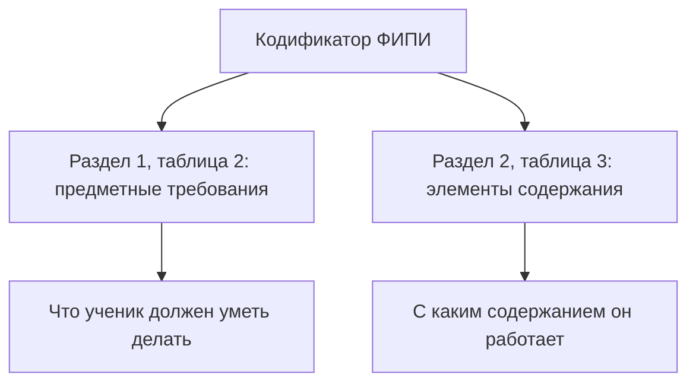
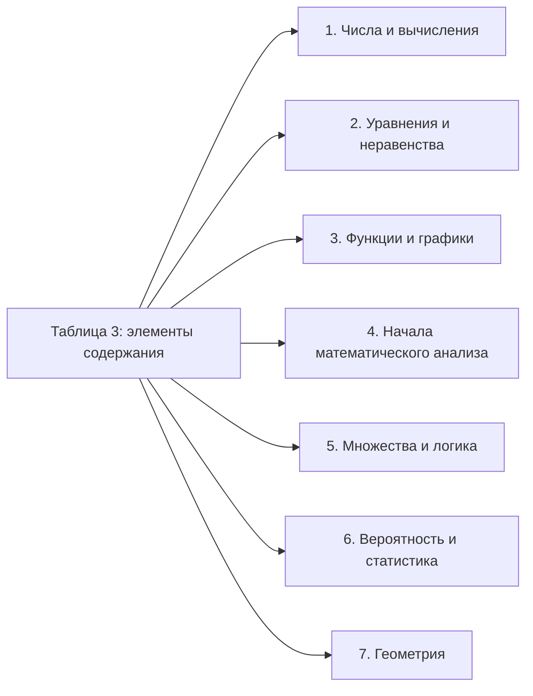
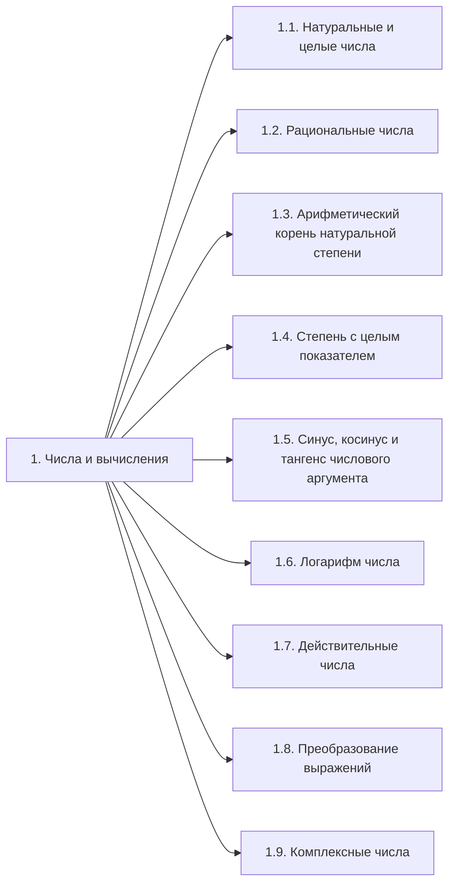
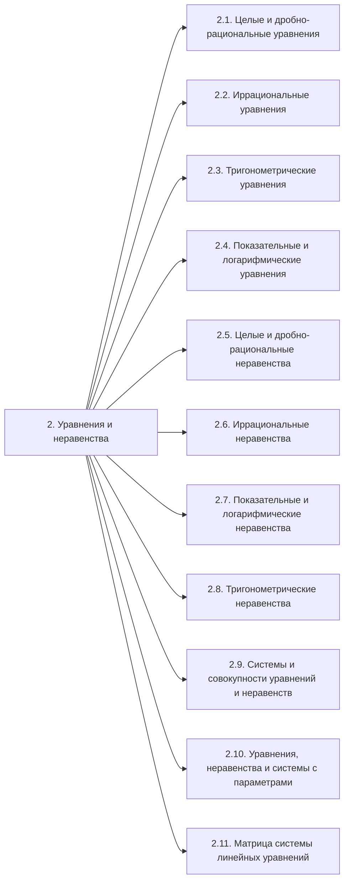
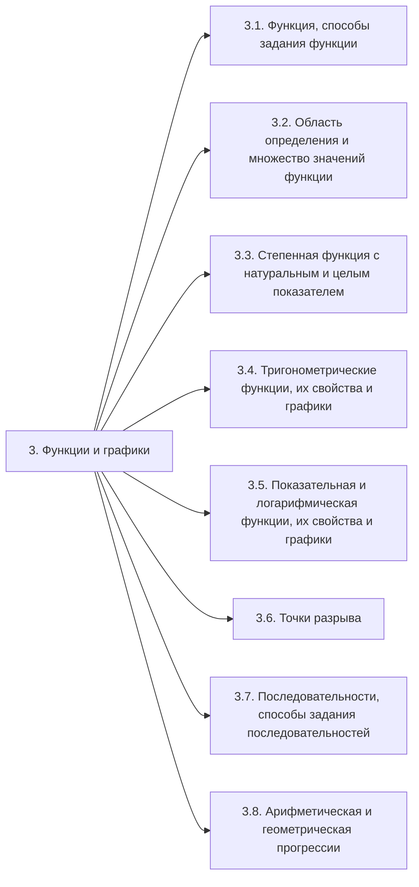
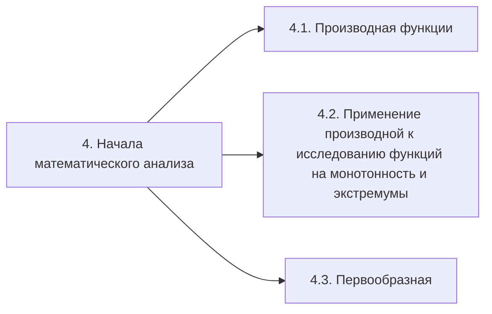
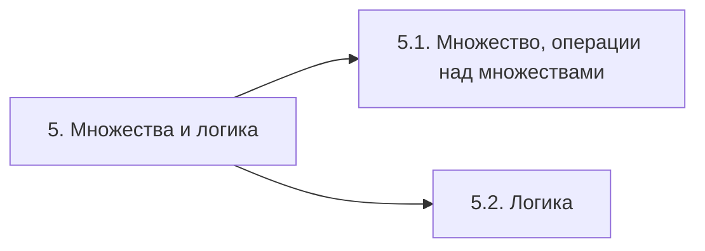
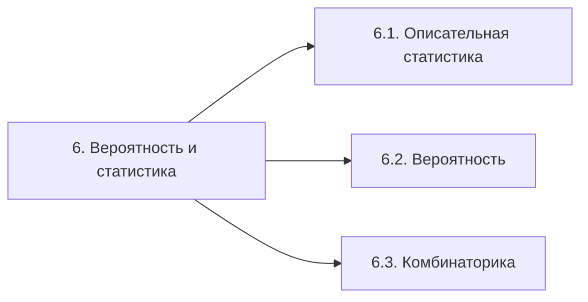
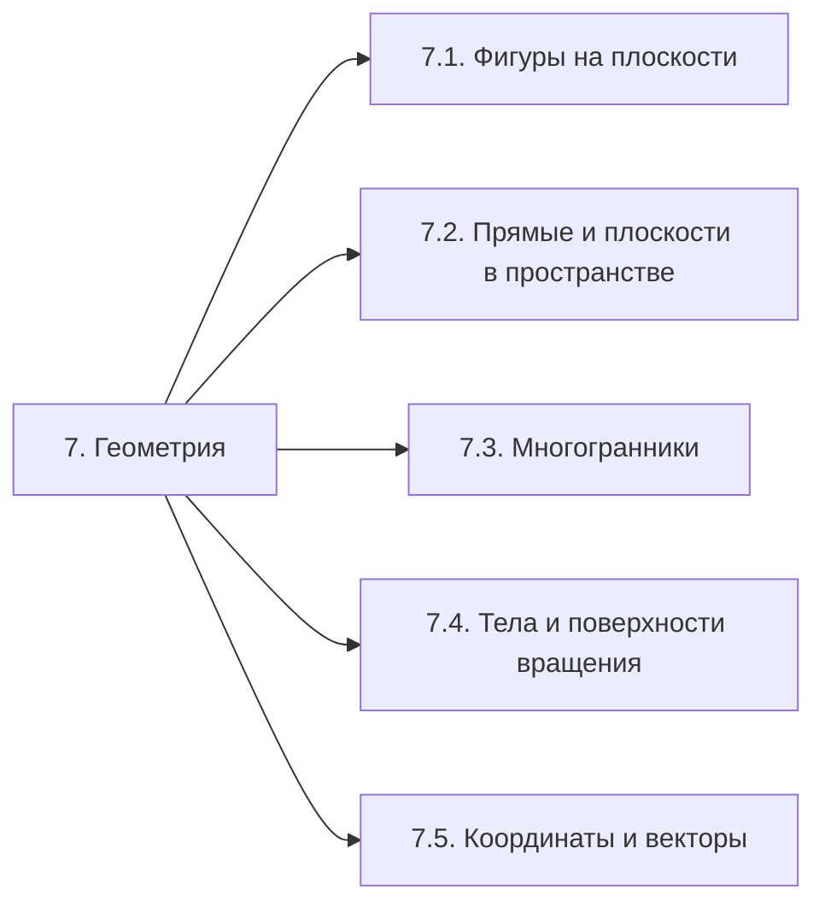

# Элементы содержания ФИПИ: официальная карта тем

Вопрос: **какое математическое содержание перечислено у ФИПИ?** Перенесён раздел 2, таблица 3 целиком: 7 групп и 41 вложенный пункт. Собственные навыки и зависимости между темами не добавлены.

Источник: «МА-11 ЕГЭ 2027_КОДИФ.pdf» из [официального ZIP ФИПИ](https://doc.fipi.ru/ege/demoversii-specifikacii-kodifikatory/2027/ma_11_2027.zip), скачанного 21 октября 2026 года. Редакция имеет гриф «ПРОЕКТ». Перенос сверен 22 октября 2026 года с изображениями страниц. Это та же редакция, что в [прочитанном обзоре](fipi-overview.md); свежая редакция сайта в рамках переноса не проверялась.

SHA-256 кодификатора: `1f6a8217fc7c0aae5e7958e2f0e3fa40e0556df431f11651680adcc2622e96b3`.

Сохранены коды, формулировки и отметки уровней ФИПИ. Убраны только переносы строк и слов, склеены продолжения ячеек между страницами. «PDF» — номер страницы файла в просмотрщике; «печатная» — номер в шапке документа. БУ/УУ относятся к уровню программы или предметных требований, а Б/П/В в спецификации — к сложности задания; это разные обозначения.

[Отдельная карта предметных требований](requirements-map.md) · [Статус этапа](README.md).

## Как читать две карты

Это два перечня с независимыми кодами. Номер требования 4 не означает автоматическую связь с группой содержания 4. Связь через номер задания приводится только по спецификации — примеры в [карте требований](requirements-map.md#связь-с-содержанием-только-по-спецификации).

## Семь групп содержания

| Код ФИПИ | Название группы | Пунктов | PDF / печатная с. |
|---|---|---:|---|
| 1 | Числа и вычисления | 9 | 7 / 13 |
| 2 | Уравнения и неравенства | 11 | 7 / 13 |
| 3 | Функции и графики | 8 | 7 / 14 |
| 4 | Начала математического анализа | 3 | 7 / 14 |
| 5 | Множества и логика | 2 | 7 / 14 |
| 6 | Вероятность и статистика | 3 | 7 / 14 |
| 7 | Геометрия | 5 | 7 / 14 |

В схемах ниже подписи пунктов сокращены только для навигации; полные официальные формулировки находятся в таблицах под ними. Стрелка означает вложенность в группу ФИПИ, а не порядок обучения и не зависимость навыков.

## 1. Числа и вычисления

| Код ФИПИ | Проверяемый элемент содержания — формулировка ФИПИ | Уровень программы | PDF / печатная с. |
|---|---|---|---|
| 1.1 | Натуральные и целые числа. Признаки делимости целых чисел | БУ, УУ | 7 / 13 |
| 1.2 | Рациональные числа. Обыкновенные и десятичные дроби, проценты, бесконечные периодические дроби | БУ, УУ | 7 / 13 |
| 1.3 | Арифметический корень натуральной степени. Действия с арифметическими корнями натуральной степени | БУ, УУ | 7 / 13 |
| 1.4 | Степень с целым показателем. Степень с рациональным показателем. Свойства степени | БУ, УУ | 7 / 13 |
| 1.5 | Синус, косинус и тангенс числового аргумента. Арксинус, арккосинус, арктангенс числового аргумента | БУ, УУ | 7 / 13 |
| 1.6 | Логарифм числа. Десятичные и натуральные логарифмы | БУ, УУ | 7 / 13 |
| 1.7 | Действительные числа. Арифметические операции с действительными числами. Приближённые вычисления, правила округления, прикидка и оценка результата вычислений | БУ, УУ | 7 / 13 |
| 1.8 | Преобразование выражений | БУ, УУ | 7 / 13 |
| 1.9 | Комплексные числа | УУ | 7 / 13 |

## 2. Уравнения и неравенства

| Код ФИПИ | Проверяемый элемент содержания — формулировка ФИПИ | Уровень программы | PDF / печатная с. |
|---|---|---|---|
| 2.1 | Целые и дробно-рациональные уравнения | БУ, УУ | 7 / 13 |
| 2.2 | Иррациональные уравнения | БУ, УУ | 7 / 13 |
| 2.3 | Тригонометрические уравнения | БУ, УУ | 7 / 13 |
| 2.4 | Показательные и логарифмические уравнения | БУ, УУ | 7 / 13 |
| 2.5 | Целые и дробно-рациональные неравенства | БУ, УУ | 7 / 13 |
| 2.6 | Иррациональные неравенства | БУ, УУ | 7 / 13 |
| 2.7 | Показательные и логарифмические неравенства | БУ, УУ | 7 / 13 |
| 2.8 | Тригонометрические неравенства | УУ | 7 / 13 |
| 2.9 | Системы и совокупности уравнений и неравенств | БУ, УУ | 7 / 13 |
| 2.10 | Уравнения, неравенства и системы с параметрами | УУ | 7 / 13 |
| 2.11 | Матрица системы линейных уравнений. Определитель матрицы | УУ | 7 / 13 |

## 3. Функции и графики

| Код ФИПИ | Проверяемый элемент содержания — формулировка ФИПИ | Уровень программы | PDF / печатная с. |
|---|---|---|---|
| 3.1 | Функция, способы задания функции. График функции. Взаимно обратные функции. Чётные и нечётные функции. Периодические функции | БУ, УУ | 7 / 14 |
| 3.2 | Область определения и множество значений функции. Нули функции. Промежутки знакопостоянства. Промежутки монотонности функции. Максимумы и минимумы функции. Наибольшее и наименьшее значение функции на промежутке | БУ, УУ | 7 / 14 |
| 3.3 | Степенная функция с натуральным и целым показателем. Её свойства и график. Свойства и график корня n-ой степени | БУ, УУ | 7 / 14 |
| 3.4 | Тригонометрические функции, их свойства и графики | БУ, УУ | 7 / 14 |
| 3.5 | Показательная и логарифмическая функции, их свойства и графики | БУ, УУ | 7 / 14 |
| 3.6 | Точки разрыва. Асимптоты графиков функций. Свойства функций, непрерывных на отрезке | УУ | 7 / 14 |
| 3.7 | Последовательности, способы задания последовательностей | БУ, УУ | 7 / 14 |
| 3.8 | Арифметическая и геометрическая прогрессии. Формула сложных процентов | БУ, УУ | 7 / 14 |

## 4. Начала математического анализа

| Код ФИПИ | Проверяемый элемент содержания — формулировка ФИПИ | Уровень программы | PDF / печатная с. |
|---|---|---|---|
| 4.1 | Производная функции. Производные элементарных функций | БУ, УУ | 7 / 14 |
| 4.2 | Применение производной к исследованию функций на монотонность и экстремумы. Нахождение наибольшего и наименьшего значения функции на отрезке | БУ, УУ | 7 / 14 |
| 4.3 | Первообразная. Интеграл | БУ, УУ | 7 / 14 |

## 5. Множества и логика

| Код ФИПИ | Проверяемый элемент содержания — формулировка ФИПИ | Уровень программы | PDF / печатная с. |
|---|---|---|---|
| 5.1 | Множество, операции над множествами. Диаграммы Эйлера – Венна | БУ, УУ | 7 / 14 |
| 5.2 | Логика | БУ, УУ | 7 / 14 |

## 6. Вероятность и статистика

| Код ФИПИ | Проверяемый элемент содержания — формулировка ФИПИ | Уровень программы | PDF / печатная с. |
|---|---|---|---|
| 6.1 | Описательная статистика | БУ, УУ | 7 / 14 |
| 6.2 | Вероятность | БУ, УУ | 7 / 14 |
| 6.3 | Комбинаторика | УУ | 7 / 14 |

## 7. Геометрия

| Код ФИПИ | Проверяемый элемент содержания — формулировка ФИПИ | Уровень программы | PDF / печатная с. |
|---|---|---|---|
| 7.1 | Фигуры на плоскости | БУ, УУ | 7 / 14 |
| 7.2 | Прямые и плоскости в пространстве | БУ, УУ | 7 / 14 |
| 7.3 | Многогранники | БУ, УУ | 7 / 14 |
| 7.4 | Тела и поверхности вращения | УУ | 7 / 14 |
| 7.5 | Координаты и векторы | УУ | 7 / 14 |

## Проверка переноса и использование

Все 7 групп и 41 подпункт учтены по одному разу, коды и уровни сверены с PDF 7 (печатные с. 13–14). Пустой уровень у заголовков групп не заменён придуманным значением. [Изображение официальной таблицы целиком](../../images/fipi-2027/codifier-content.png).

Кодификатор общий для математики и содержит отметки БУ/УУ; наличие пункта в перечне само по себе не задаёт отдельный номер экзаменационного задания. Спецификацию для профильного уровня используем отдельно. Эта карта — основа для поиска задач, решений и объяснений и последующей проверки покрытия. Материалы к пунктам пока не собраны. Карта подготовлена для просмотра пользователем, её просмотр ещё не подтверждён.
