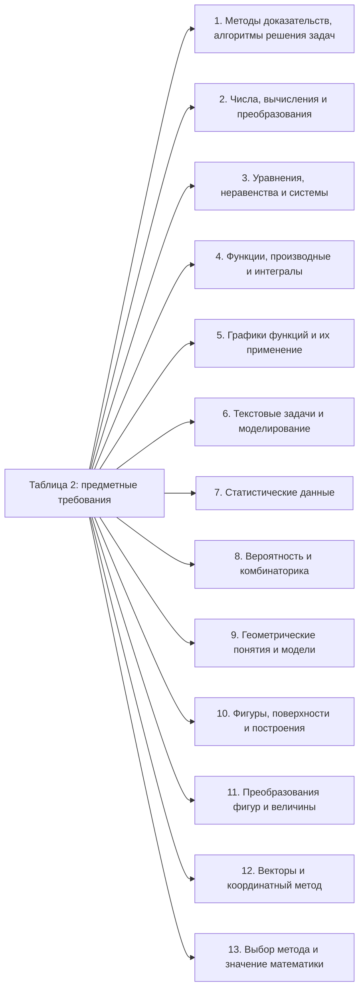
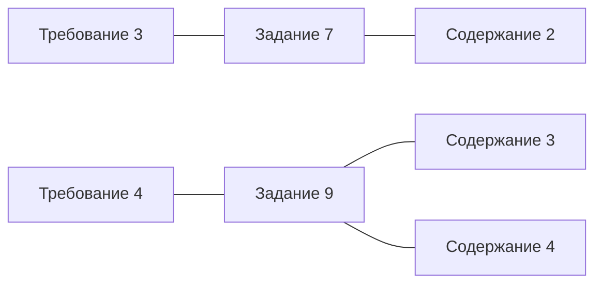

# Предметные требования ФИПИ: отдельный перечень

Вопрос: **что ученик должен уметь делать по требованиям ФИПИ?** Перенесена таблица 2 раздела 1: все 13 предметных требований. Это официальные требования к результатам обучения, а не собственные атомарные навыки проекта.

Источник: «МА-11 ЕГЭ 2027_КОДИФ.pdf» из [официального ZIP ФИПИ](https://doc.fipi.ru/ege/demoversii-specifikacii-kodifikatory/2027/ma_11_2027.zip), скачанного 21 октября 2026 года. Редакция имеет гриф «ПРОЕКТ». Перенос сверен 22 октября 2026 года с изображениями страниц. Это та же редакция, что в [прочитанном обзоре](fipi-overview.md); свежая редакция сайта в рамках переноса не проверялась.

SHA-256 кодификатора: `1f6a8217fc7c0aae5e7958e2f0e3fa40e0556df431f11651680adcc2622e96b3`.

Сохранены коды, формулировки и отметки уровней ФИПИ. Убраны только переносы строк и слов, склеены продолжения ячеек между страницами. «PDF» — номер страницы файла в просмотрщике; «печатная» — номер в шапке документа. БУ/УУ относятся к уровню программы или предметных требований, а Б/П/В в спецификации — к сложности задания; это разные обозначения.

[Карта элементов содержания](content-map.md) · [Статус этапа](README.md).

## Границы переноса

Таблица 1 раздела 1 содержит метапредметные требования; она здесь не переносится целиком. Ссылки на неё из столбца «Метапредметный результат» таблицы 2 сохранены как у ФИПИ. Раздел 3 о личностных результатах описан в [обзоре](fipi-overview.md#4-кодификатор-как-он-организован-у-фипи) и тоже не является предметным перечнем этой карты.

## Обзор требований

Подписи схемы — сокращённые пояснения для навигации, не новые категории ФИПИ. Все 13 требований остаются на одном уровне; стрелки обозначают только принадлежность перечню. Полные формулировки — в таблице ниже.

## Полные формулировки таблицы 2

| Код требования | Формулировка ФИПИ | Уровень предметных требований ФГОС | Метапредметный результат | PDF / печатные с. |
|---|---|---|---|---|
| 1 | Владение методами доказательств, алгоритмами решения задач; умение формулировать и оперировать понятиями: определение, аксиома, теорема, следствие, свойство, признак, доказательство, равносильные формулировки; применять их; умение формулировать обратное и противоположное утверждение, приводить примеры и контрпримеры, использовать метод математической индукции; проводить доказательные рассуждения при решении задач, оценивать логическую правильность рассуждений; умение оперировать понятиями: множество, подмножество, операции над множествами; умение использовать теоретико-множественный аппарат для описания реальных процессов и явлений и при решении задач, в том числе из других учебных предметов; умение оперировать понятиями: граф, связный граф, дерево, цикл, граф на плоскости; умение задавать и описывать графы различными способами; использовать графы при решении задач | БУ, УУ | МП 1.1; 1.2; 1.3; 3.1; 3.2 | 3 / 6 |
| 2 | Умение оперировать понятиями: натуральное число, целое число, степень с целым показателем, корень натуральной степени, степень с рациональным показателем, степень с действительным показателем, логарифм числа, синус, косинус и тангенс произвольного числа, остаток по модулю, рациональное число, иррациональное число, множества натуральных, целых, рациональных, действительных чисел; умение использовать признаки делимости, алгоритм Евклида при решении задач; знакомство с различными позиционными системами счисления; умение выполнять вычисление значений и преобразования выражений со степенями и логарифмами, преобразования дробно-рациональных выражений; умение оперировать понятиями: последовательность, арифметическая прогрессия, геометрическая прогрессия, бесконечно убывающая геометрическая прогрессия; умение задавать последовательности, в том числе с помощью рекуррентных формул; умение оперировать понятиями: комплексное число, сопряжённые комплексные числа, модуль и аргумент комплексного числа, форма записи комплексных чисел (геометрическая, тригонометрическая и алгебраическая); уметь производить арифметические действия с комплексными числами; приводить примеры использования комплексных чисел; оперировать понятиями: матрица 2×2 и 3×3, определитель матрицы, геометрический смысл определителя | БУ, УУ | МП 1.1; 1.3; 3.1; 3.2 | 3, 4 / 6, 7 |
| 3 | Умение оперировать понятиями: рациональные, иррациональные, показательные, степенные, логарифмические, тригонометрические уравнения и неравенства, их системы; умение оперировать понятиями: тождество, тождественное преобразование, уравнение, неравенство, система уравнений и неравенств, равносильность уравнений, неравенств и систем; умение решать уравнения, неравенства и системы с помощью различных приёмов; решать уравнения, неравенства и системы с параметром; применять уравнения, неравенства, их системы для решения математических задач и задач из различных областей науки и реальной жизни | БУ, УУ | МП 1.1; 1.3; 3.1; 3.2 | 4 / 7 |
| 4 | Умение оперировать понятиями: функция, чётность функции, периодичность функции, ограниченность функции, монотонность функции, экстремум функции, наибольшее и наименьшее значения функции на промежутке, непрерывная функция, асимптоты графика функции, первая и вторая производная функции, геометрический и физический смысл производной, первообразная, определённый интеграл; умение находить асимптоты графика функции; умение вычислять производные суммы, произведения, частного и композиции функций, находить уравнение касательной к графику функции; умение находить производные элементарных функций; умение использовать производную для исследования функций, находить наибольшие и наименьшие значения функций; строить графики многочленов с использованием аппарата математического анализа; применять производную для нахождения наилучшего решения в прикладных, в том числе социально-экономических и физических задачах; находить площади и объёмы фигур с помощью интеграла; приводить примеры математического моделирования с помощью дифференциальных уравнений | БУ, УУ | МП 1.1; 1.2; 1.3; 3.1; 3.2 | 4 / 8 |
| 5 | Умение оперировать понятиями: график функции, обратная функция, композиция функций, линейная функция, квадратичная функция, рациональная функция, степенная функция, тригонометрические функции, обратные тригонометрические функции, показательная и логарифмическая функции; умение строить графики изученных функций, выполнять преобразования графиков функций, использовать графики для изучения процессов и зависимостей, при решении задач из других учебных предметов и задач из реальной жизни; выражать формулами зависимости между величинами; использовать свойства и графики функций для решения уравнений, неравенств и задач с параметрами; изображать на координатной плоскости множества решений уравнений, неравенств и их систем | БУ, УУ | МП 1.1; 1.2; 1.3; 3.1; 3.2 | 4, 5 / 8, 9 |
| 6 | Умение решать текстовые задачи разных типов (в том числе на проценты, доли и части, на движение, работу, стоимость товаров и услуг, налоги, задачи из области управления личными и семейными финансами); составлять выражения, уравнения, неравенства и их системы по условию задачи, исследовать полученное решение и оценивать правдоподобность результатов; умение моделировать реальные ситуации на языке математики; составлять выражения, уравнения, неравенства и их системы по условию задачи, исследовать построенные модели с использованием аппарата алгебры, интерпретировать полученный результат | БУ, УУ | МП 1.1; 1.2; 1.3; 3.1; 3.2 | 5 / 9 |
| 7 | Умение оперировать понятиями: среднее арифметическое, медиана, наибольшее и наименьшее значения, размах, дисперсия, стандартное отклонение числового набора; умение извлекать, интерпретировать информацию, представленную в таблицах, на диаграммах, графиках, отражающую свойства реальных процессов и явлений; представлять информацию с помощью таблиц и диаграмм; исследовать статистические данные, в том числе с применением графических методов и электронных средств; графически исследовать совместные наблюдения с помощью диаграмм рассеивания и линейной регрессии | БУ, УУ | МП 1.1; 1.2; 1.3; 3.1; 3.2 | 5 / 9 |
| 8 | Умение оперировать понятиями: случайный опыт и случайное событие, вероятность случайного события; умение вычислять вероятность с использованием графических методов; применять формулы сложения и умножения вероятностей, формулу полной вероятности, формулу Бернулли, комбинаторные факты и формулы; оценивать вероятности реальных событий; умение оперировать понятиями: случайная величина, распределение вероятностей, математическое ожидание, дисперсия и стандартное отклонение случайной величины, функции распределения и плотности равномерного, показательного и нормального распределений; умение использовать свойства изученных распределений для решения задач; знакомство с понятиями: закон больших чисел, методы выборочных исследований; умение приводить примеры проявления закона больших чисел в природных и общественных явлениях; умение оперировать понятиями: сочетание, перестановка, число сочетаний, число перестановок; бином Ньютона; умение применять комбинаторные факты и рассуждения для решения задач; оценивать вероятности реальных событий; составлять вероятностную модель и интерпретировать полученный результат | БУ, УУ | МП 1.1; 1.2; 1.3; 3.1; 3.2 | 5 / 10 |
| 9 | Умение оперировать понятиями: точка, прямая, плоскость, пространство, отрезок, луч, величина угла, плоский угол, двугранный угол, трёхгранный угол, скрещивающиеся прямые, параллельность и перпендикулярность прямых и плоскостей, угол между прямыми, угол между прямой и плоскостью, угол между плоскостями, расстояние от точки до плоскости, расстояние между прямыми, расстояние между плоскостями; умение использовать при решении задач изученные факты и теоремы планиметрии; умение оценивать размеры объектов окружающего мира; строить математические модели с помощью геометрических понятий и величин, решать связанные с ними практические задачи | БУ, УУ | МП 1.1; 1.3; 3.2 | 5, 6 / 10, 11 |
| 10 | Умение оперировать понятиями: площадь фигуры, объём фигуры, многогранник, правильный многогранник, сечение многогранника, куб, параллелепипед, призма, пирамида, фигура и поверхность вращения, цилиндр, конус, шар, сфера, площадь сферы, площадь поверхности пирамиды, призмы, конуса, цилиндра, объём куба, прямоугольного параллелепипеда, пирамиды, призмы, цилиндра, конуса, шара, развёртка поверхности, сечения конуса и цилиндра, параллельные оси или основанию, сечение шара, плоскость, касающаяся сферы, цилиндра, конуса; умение строить сечение многогранника, изображать многогранники, фигуры и поверхности вращения, их сечения, в том числе с помощью электронных средств; умение применять свойства геометрических фигур, самостоятельно формулировать определения изучаемых фигур, выдвигать гипотезы о свойствах и признаках геометрических фигур, обосновывать или опровергать их; умение проводить классификацию фигур по различным признакам, выполнять необходимые дополнительные построения | БУ, УУ | МП 1.1; 1.2; 1.3; 3.1; 3.2 | 6 / 11 |
| 11 | Умение оперировать понятиями: движение в пространстве, параллельный перенос, симметрия на плоскости и в пространстве, поворот, преобразование подобия, подобные фигуры; умение распознавать равные и подобные фигуры, в том числе в природе, искусстве, архитектуре; использовать геометрические отношения при решении задач; находить геометрические величины (длина, угол, площадь, объём) при решении задач из других учебных предметов и из реальной жизни; умение вычислять геометрические величины (длина, угол, площадь, объём, площадь поверхности), используя изученные формулы и методы, в том числе: площадь поверхности пирамиды, призмы, конуса, цилиндра, площадь сферы; объём куба, прямоугольного параллелепипеда, пирамиды, призмы, цилиндра, конуса, шара; умение находить отношение объёмов подобных фигур | БУ, УУ | МП 1.1; 1.2; 1.3; 3.1; 3.2 | 6 / 11, 12 |
| 12 | Умение оперировать понятиями: прямоугольная система координат, вектор, координаты точки, координаты вектора, сумма векторов, произведение вектора на число, разложение вектора по базису, скалярное произведение, векторное произведение, угол между векторами; умение использовать векторный и координатный метод для решения геометрических задач и задач других учебных предметов | БУ, УУ | МП 1.1; 1.3; 3.1; 3.2 | 6 / 12 |
| 13 | Умение выбирать подходящий метод для решения задачи; понимание значимости математики в изучении природных общественных процессов и явлений; умение распознавать проявление законов математики в искусстве, умение приводить примеры математических открытий российской и мировой математической науки | БУ, УУ | МП 1.1; 1.2; 1.3; 3.1; 3.2 | 6 / 12 |

## Связь с содержанием только по спецификации

Официальное основание — приложение «Обобщённый план варианта КИМ ЕГЭ 2027 года» в файле «МА-11 ЕГЭ 2027 СПЕЦ_профильный.pdf» из того же ZIP. В нём у каждого номера отдельно указаны коды проверяемых требований и коды содержания. Эти связи относятся к позиции экзаменационной работы, не задают зависимостей между навыками.

Два примера переноса связей (не полная карта приложения):

| № задания | Коды требований по спецификации | Коды содержания по спецификации | Источник |
|---|---|---|---|
| 7 | 3 | 2 | Спецификация, PDF 9, печатная с. 14 |
| 9 | 4 | 3, 4 | Спецификация, PDF 9, печатная с. 14 |

Таким образом, требование 4 связано в позиции 9 с двумя группами содержания, а не только с группой с совпадающим кодом. Детальные подпункты таблицы 3 к этим примерам не приписывались.

## Проверка и статус

Учтены требования 1–13. Продолжения требований 2, 5, 9 и 11 склеены между печатными страницами; у них сохранены обе ссылки на страницы. Текст, отметки уровней и ссылки МП сверены по изображениям печатных с. 6–12 (PDF 3–6). Формулировки источника не редактировались по смыслу. Перенос подготовлен для просмотра пользователем; статус просмотра старого обзора на него не распространяется.
