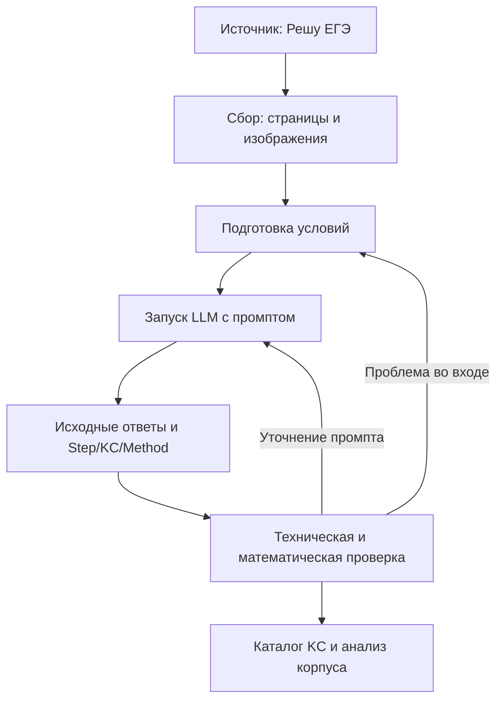

# 03. Что исследовать в математической структуре?

**Статус:** перечень вопросов и возможных метрик, не результаты. Уточняем после выбора единиц и способа разметки.

## Главный вопрос

Что можно узнать **о математических задачах и способах их решения**, когда у нас есть связи «задача — шаг — кандидатный KC — метод»?

## Предварительные направления анализа

- **Покрытие:** какие темы и требования ФИПИ представлены задачами, решениями и кандидатными KC, а где пробелы.
- **Повторяемость:** какие KC встречаются в разных решениях, задачах и разделах.
- **Частоты:** сколько раз встречаются KC/методы в нашем корпусе; доля единичных кандидатов.
- **Сочетания:** какие KC появляются в одном решении и какие связки повторяются.
- **Структура решения:** количество содержательных шагов, последовательности, наличие разных методов и путей.
- **Качество представления:** пропущенные/ошибочные шаги, стабильность LLM, дубли KC, согласованность разметки и трудозатраты.

## Границы выводов

Частоты в 19 задачах относятся **только к этому небольшому пробному корпусу**, не ко всей математике ЕГЭ. Совместная встречаемость и порядок действий **не доказывают** prerequisite или перенос обучения. Статистика освоения навыков учениками потребует их собственных попыток.

Детальное проектирование подсказок, адаптации и проверка их эффективности — последующие этапы проекта.

## Source review 2 — рабочая схема пайплайна

**Дата:** 25 октября 2026 года. **Статус:** набросок по итогам обсуждения с пользователем; реализация и запуск не выполнены. Это проектная схема, а не новый обзор научных источников. Состав артефактов и среду выполнения обсудим следующим шагом.

Сейчас отлаживаем полный путь на пробном корпусе из 19 заданий. Код предполагается организовать так, чтобы затем обрабатывать больший корпус.

### Как предполагается выполнять

| Часть | Назначение |
|---|---|
| Сборщик | Загружает задания и изображения, сохраняет ссылки на источник и оригиналы |
| Подготовка | Выделяет условие, обрабатывает формулы, готовит рисунки и отмечает потери |
| Запуск | Подставляет одно задание в промпт, вызывает модель, сохраняет ответ; позволяет продолжить после сбоя |
| Проверка | Проверяет JSON и связи сущностей, подготавливает материалы для проверки математики и разметки |
| Анализ | Сопоставляет кандидатные KC между задачами, формирует предварительный каталог и считает выбранные статистики |

Исходные материалы уже частично подготовлены: [корпус tasks.jsonl](../../../data/processed/sdamgia/90702516/tasks.jsonl), [страницы и изображения](../../../data/raw/sdamgia/90702516/), [происхождение и ограничения набора](../03-dataset/sdamgia-90702516.md). Начинаем с сохранённых материалов.

Для генерации модель получает **условие с необходимыми формулами и рисунками** и самостоятельно строит решение и разметку. Сохранённые ответы и решения источника используются отдельно при последующей проверке; они сами требуют предметной проверки. [Промпт A](02.1-prompting-pilot/prompts/A.txt) — предварительная отправная точка.

### Форматы и способ управления — предложения

- JSON/JSONL подходит для структурированных записей заданий и разметки; рисунки остаются отдельными файлами, исходный HTML сохраняется.
- Для человека нужен читаемый просмотр условия и полученного решения с разметкой.
- Возможный способ локальной отладки: ноутбук как пульт управления, функции обработки и запуска — в Python-модулях. После отладки те же функции можно запускать одной командой.
- Агентский режим можно использовать для разработки и отладки кода. Конкретная среда, механизм вызова LLM и модель пока не выбраны.

### Порядок отладки

1. Пройти весь путь на двух разных заданиях: с формулами и с рисунком.
2. Зафиксировать проблемы входных данных, запуска и сохранения результатов.
3. После исправлений зафиксировать версии входов и промпта, пройти корпус из 19 заданий.
4. Каждое ручное вмешательство учитывать: что можно автоматизировать, что требует проверки человеком.
5. По результатам определить, готов ли процесс к расширению корпуса.

**Следующее обсуждение:** необходимые артефакты, их размещение, среда выполнения и способ запуска. Схема не означает, что код пайплайна, новый запуск на 19 заданиях или каталог KC уже готовы.
