# Просмотр границ KC: 19 задач и пять карточек

26 октября 2026. **Предложения для обсуждения, не согласованные правила.**

Сопоставлены все 57 сохранённых решений. Ни исходные ответы, ни каталог из 155 кандидатов, ни прежние метрики не изменены. Новых генераций не было. Это интерпретация основного агента, не независимая предметная экспертиза.

Цель — различить переименование, границы составных KC и содержательные варианты решения. Отсутствие отдельного KC не доказывает отсутствия действия: нужно читать шаги. Средний Жаккар ниже взят из прежнего каталога; это не оценка правильности решения.

## Пять показательных карточек

### Карточка 1. №1: Разные названия одного действия

Задача `699085` · [сохранённый вход](../../../data/annotation/runs/2026-10-25-A-19x3/inputs/699085.json) · KC r1/r2/r3: **2/2/2** · прежний средний Жаккар: **1.000**.

Условие: доступный текст ниже может содержать машинные названия символов; точные формулы и рисунки сохранены в изображениях.

```text
[рисунок] В треугольнике ABC AD — биссектриса, угол C равен 54°, угол CAD равен 30°. Найдите угол B. Ответ дайте в градусах.
```

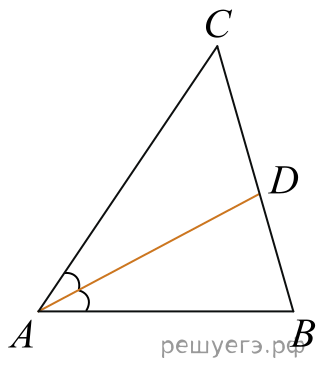

**Точные фрагменты KC** (локальные ID действуют только внутри своего ответа):

**[r1: полный ответ и шаги](../../../data/annotation/runs/2026-10-25-A-19x3/raw/699085_r1.txt)**

- `k1` **Вычислять угол по его половине, заданной биссектрисой**. Использовать равенство углов, на которые биссектриса делит угол, и находить весь угол удвоением одной из его половин.
- `k2` **Находить третий угол треугольника по двум известным**. Вычитать сумму двух известных внутренних углов треугольника из 180 градусов.

**[r2: полный ответ и шаги](../../../data/annotation/runs/2026-10-25-A-19x3/raw/699085_r2.txt)**

- `k1` **Находить полный угол по половине, образованной биссектрисой**. Использовать равенство двух углов, на которые биссектриса делит исходный угол, и удваивать известную половину.
- `k2` **Находить угол треугольника по двум другим углам**. Вычитать сумму двух известных внутренних углов из 180° для определения третьего угла треугольника.

**[r3: полный ответ и шаги](../../../data/annotation/runs/2026-10-25-A-19x3/raw/699085_r3.txt)**

- `k1` **Находить полный угол по его половине, заданной биссектрисой**. Использовать равенство двух углов, на которые биссектриса делит угол, и удваивать известную половину для получения полного угла.
- `k2` **Находить неизвестный угол треугольника по двум известным**. Вычитать сумму двух известных внутренних углов треугольника из 180° для вычисления третьего угла.

**Сопоставление действий:** Во всех повторах восстановлен полный угол по биссектрисе и затем найден третий угол треугольника. Различаются формулировки, не действия.

Исходный каталог уже сопоставил эти формулировки: средний Жаккар равен 1. Новое правило здесь не требуется; важно не путать переименование с изменением умения.

**Предложение:** Сохранить два общих KC; это контрольный пример допустимого объединения синонимов.

**Для обсуждения:** Согласны ли считать эти формулировки двумя одинаковыми умениями во всех повторах?

### Карточка 2. №2: Один составной KC вместо двух

Задача `699086` · [сохранённый вход](../../../data/annotation/runs/2026-10-25-A-19x3/inputs/699086.json) · KC r1/r2/r3: **4/3/4** · прежний средний Жаккар: **0.600**.

Условие: доступный текст ниже может содержать машинные названия символов; точные формулы и рисунки сохранены в изображениях.

```text
[рисунок] На координатной плоскости изображены векторы \veca и \vecb. Найдите длину вектора \veca плюс \vecb.
```

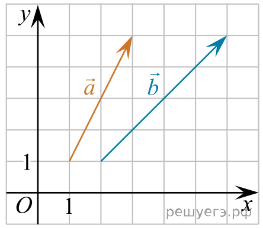

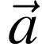

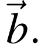

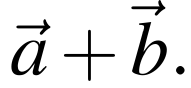

**Точные фрагменты KC** (локальные ID действуют только внутри своего ответа):

**[r1: полный ответ и шаги](../../../data/annotation/runs/2026-10-25-A-19x3/raw/699086_r1.txt)**

- `k1` **Считывать координаты точек по координатной сетке**. Определять абсциссу и ординату отмеченной точки с учётом направлений осей и масштаба координатной сетки.
- `k2` **Вычислять координаты направленного вектора по его концам**. Вычитать координаты начала вектора из соответствующих координат его конца.

**[r2: полный ответ и шаги](../../../data/annotation/runs/2026-10-25-A-19x3/raw/699086_r2.txt)**

- `k1` **Определять координаты вектора по рисунку**. Считывать координаты начала и конца направленного отрезка на координатной плоскости и вычитать координаты начала из соответствующих координат конца.

**[r3: полный ответ и шаги](../../../data/annotation/runs/2026-10-25-A-19x3/raw/699086_r3.txt)**

- `k1` **Считывать координаты точек по координатной сетке**. Определять абсциссу и ординату точки по положению относительно начала координат с учётом масштаба осей.
- `k2` **Находить координаты вектора по его началу и концу**. Вычитать из каждой координаты конца вектора соответствующую координату его начала.

**Сопоставление действий:** r1/r3 разделяют чтение координат точек и вычитание координат концов вектора; r2 включает оба действия в k1. Сложение и длина вектора совпадают.

Описание r2:k1 явно содержит оба действия. Их разделение может помочь различать ошибку чтения рисунка и ошибку вычитания. Это гипотеза для диагностики, ещё не проверенная на учениках.

**Предложение:** Предложить два отдельных KC для чтения координат и вычисления координат вектора; для составного r2:k1 сохранить связь с обоими и основание по шагу.

**Для обсуждения:** Разделяем ли чтение координат и вычисление координат вектора?

### Карточка 3. №6: Два разных способа проверки

Задача `699090` · [сохранённый вход](../../../data/annotation/runs/2026-10-25-A-19x3/inputs/699090.json) · KC r1/r2/r3: **3/4/3** · прежний средний Жаккар: **0.444**.

Условие: доступный текст ниже может содержать машинные названия символов; точные формулы и рисунки сохранены в изображениях.

```text
Найдите корень уравнения корень из: начало аргумента: 76 минус 2x конец аргумента = 8.
```

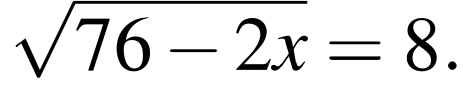

**Точные фрагменты KC** (локальные ID действуют только внутри своего ответа):

**[r1: полный ответ и шаги](../../../data/annotation/runs/2026-10-25-A-19x3/raw/699090_r1.txt)**

- `k2` **Решать линейное уравнение с одной переменной**. Переносить постоянные слагаемые и делить обе части уравнения на ненулевой коэффициент при переменной для нахождения единственного корня.
- `k3` **Проверять корень подстановкой в исходное уравнение**. Подставлять найденное значение переменной, проверять определённость выражений и равенство обеих частей исходного уравнения.

**[r2: полный ответ и шаги](../../../data/annotation/runs/2026-10-25-A-19x3/raw/699090_r2.txt)**

- `k1` **Задавать ограничение для арифметического квадратного корня**. При работе над действительными числами требовать неотрицательности подкоренного выражения.
- `k2` **Решать линейное уравнение или неравенство**. Переносить слагаемые и делить на ненулевой коэффициент при неизвестной; при делении неравенства на отрицательное число менять знак неравенства.
- `k4` **Проверять принадлежность найденного корня области допустимых значений**. Сопоставлять полученное значение неизвестной с ограничениями исходного уравнения и сохранять только допустимые значения.

**[r3: полный ответ и шаги](../../../data/annotation/runs/2026-10-25-A-19x3/raw/699090_r3.txt)**

- `k2` **Решать линейное уравнение с одной переменной**. Переносить свободные члены и делить обе части уравнения на ненулевой коэффициент при переменной.
- `k3` **Проверять корень подстановкой в иррациональное уравнение**. Подставлять найденное значение переменной, проверять неотрицательность подкоренного выражения и равенство частей исходного уравнения.

**Сопоставление действий:** r1/r3 проверяют найденный корень подстановкой; r2 явно задаёт ОДЗ и проверяет принадлежность ей после равносильного перехода. r2:k2 объединяет уравнение и неравенство.

Все получают x=6 для уравнения с квадратным корнем. r2 сначала выводит x≤38, затем использует равносильность возведения в квадрат и проверяет 6≤38. r1/r3 выполняют подстановку в исходное уравнение. Эти действия связаны, но не тождественны. Отсутствие отдельной подстановки в r2 само по себе не означает математическую ошибку.

**Предложение:** Сохранять различие проверок; отдельно связать применения линейного уравнения и неравенства с соответствующими шагами.

**Для обсуждения:** Храним ли проверку ОДЗ и проверку подстановкой раздельно?

### Карточка 4. №8: Нулевой Жаккар при одном решении

Задача `699092` · [сохранённый вход](../../../data/annotation/runs/2026-10-25-A-19x3/inputs/699092.json) · KC r1/r2/r3: **2/2/3** · прежний средний Жаккар: **0.333**.

Условие: доступный текст ниже может содержать машинные названия символов; точные формулы и рисунки сохранены в изображениях.

```text
На рисунке изображен график производной функции f левая круглая скобка x правая круглая скобка , определенной на интервале левая круглая скобка минус 7; 14 правая круглая скобка . Найдите количество точек максимума функции f левая круглая скобка x правая круглая скобка на отрезке левая квадратная скобка минус 6;9 правая квадратная скобка . [рисунок]
```

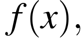

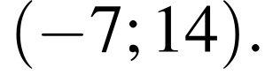

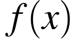

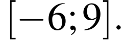

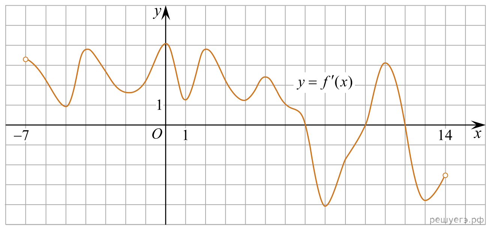

**Точные фрагменты KC** (локальные ID действуют только внутри своего ответа):

**[r1: полный ответ и шаги](../../../data/annotation/runs/2026-10-25-A-19x3/raw/699092_r1.txt)**

- `k1` **Определять нули и знаки производной по её графику**. На заданном промежутке находить пересечения графика производной с осью абсцисс и определять знак производной по положению графика относительно этой оси.
- `k2` **Находить точки максимума по смене знака производной**. Выделять точки перехода производной от положительных значений к отрицательным и обосновывать полноту поиска локальных максимумов с учётом области определения функции.

**[r2: полный ответ и шаги](../../../data/annotation/runs/2026-10-25-A-19x3/raw/699092_r2.txt)**

- `k1` **Определять знак производной по её графику**. Устанавливать интервалы положительных и отрицательных значений производной и её нули по расположению графика относительно оси абсцисс в заданном промежутке.
- `k2` **Выявлять точки максимума по смене знака производной**. Устанавливать локальный максимум функции в точке, где производная меняет знак с положительного на отрицательный, и отбирать такие точки в заданном промежутке.

**[r3: полный ответ и шаги](../../../data/annotation/runs/2026-10-25-A-19x3/raw/699092_r3.txt)**

- `k1` **Определять точки максимума по смене знака производной**. Применять достаточный признак локального максимума: переход знака производной с положительного на отрицательный при прохождении через рассматриваемую точку.
- `k2` **Считывать нули и знаки функции по графику**. Находить абсциссы пересечений графика с осью абсцисс и определять знак функции по расположению графика выше или ниже этой оси.
- `k3` **Отбирать и подсчитывать точки в заданном промежутке**. Проверять принадлежность найденных точек указанному промежутку, учитывать его границы и подсчитывать точки, удовлетворяющие требуемому условию.

**Сопоставление действий:** Один графический ход и ответ 1. В r1/r2 поиск максимумов включает полноту или отбор; r3 выделяет отбор отдельно и описывает чтение графика для функции вообще, а не только производной.

В текущем консервативном каталоге r1/r2 дают Жаккар 1, а r1/r3 и r2/r3 — 0: ни один ID с r3 не совпал из-за объёма определений. Во всех решениях производная положительна слева от 7 и отрицательна справа, найден один максимум. r3 сначала формулирует признак, затем читает график; это перестановка объяснения, а не новый метод. Число 0 здесь не означает отсутствия общих математических действий.

**Предложение:** Предложить три операции: чтение нулей/знаков графика, применение признака максимума, отбор/подсчёт на отрезке. Привязывать к шагам и контексту производной, не объявляя широкие и узкие определения тождественными.

**Для обсуждения:** Согласны ли на три операции с отдельным хранением контекста их применения?

### Карточка 5. №19: Различие доказательств, которое стоит сохранить

Задача `699103` · [сохранённый вход](../../../data/annotation/runs/2026-10-25-A-19x3/inputs/699103.json) · KC r1/r2/r3: **7/8/11** · прежний средний Жаккар: **0.252**.

Условие: доступный текст ниже может содержать машинные названия символов; точные формулы и рисунки сохранены в изображениях.

```text
а) Можно ли представить число 2043 в виде суммы двух различных натуральных чисел, сумма цифр которых одинакова?б) Можно ли представить число 599 в виде суммы двух различных натуральных чисел, сумма цифр которых одинакова?в) Найдите наименьшее число, которое можно представить в виде суммы семи различных натуральных чисел, сумма цифр которых одинакова.
```

**Точные фрагменты KC** (локальные ID действуют только внутри своего ответа):

**[r1: полный ответ и шаги](../../../data/annotation/runs/2026-10-25-A-19x3/raw/699103_r1.txt)**

- `k4` **Связывать число с его суммой цифр**. Использовать неравенство между натуральным числом и суммой его цифр и их сравнимость по модулю девять.
- `k5` **Оценивать сумму упорядоченных различных чисел**. Получать нижние границы отдельных слагаемых из их порядка, общего остатка и дополнительных ограничений, затем складывать эти границы.
- `k6` **Перечислять числа с заданной суммой цифр в ограниченном диапазоне**. Представлять числа разрядными цифрами, решать ограничение на их сумму и подсчитывать допустимые записи с учётом ведущих нулей.
- `k7` **Вычислять сумму арифметической прогрессии**. Находить сумму конечной арифметической прогрессии по числу членов и её крайним членам.

**[r2: полный ответ и шаги](../../../data/annotation/runs/2026-10-25-A-19x3/raw/699103_r2.txt)**

- `k4` **Связывать число с суммой его цифр по модулю девять**. Использовать сравнение натурального числа и суммы его десятичных цифр по модулю девять, чтобы ограничить разности чисел с одинаковой суммой цифр.
- `k5` **Оценивать число снизу суммой его цифр**. Сравнивать десятичное число с суммой его цифр на основании того, что вес каждого разряда не меньше единицы.
- `k6` **Оценивать сумму упорядоченных чисел снизу**. Суммировать нижние границы элементов с учётом их различности, минимального интервала или количества элементов ниже заданного порога.
- `k7` **Перечислять числа с заданной суммой цифр**. Параметризовать допустимые десятичные цифры при фиксированной сумме и ограничении на количество разрядов, проверяя полноту перечня.
- `k8` **Доказывать минимум нижней оценкой и примером**. Покрывать все допустимые случаи нижними оценками целевой величины и предъявлять допустимый объект, достигающий общей границы.

**[r3: полный ответ и шаги](../../../data/annotation/runs/2026-10-25-A-19x3/raw/699103_r3.txt)**

- `k6` **Оценивать число через сумму его цифр**. Использовать десятичное разложение для вывода, что натуральное число не меньше суммы его цифр.
- `k7` **Ограничивать промежутки между числами через сравнение по модулю**. Использовать сравнимость числа с суммой его цифр по модулю девять, чтобы получить нижнюю границу положительной разности различных чисел с равными суммами цифр.
- `k8` **Подсчитывать числа с заданной суммой цифр**. Представлять числа ограниченной длины наборами цифр и считать допустимые наборы с заданной суммой, включая ведущие нули для коротких записей.
- `k9` **Суммировать арифметическую прогрессию и почленные оценки**. Вычислять сумму арифметической прогрессии и складывать почленные нижние границы для получения оценки суммы.
- `k10` **Доказывать оценку разбиением на случаи**. Разбивать возможные значения целочисленного параметра на исчерпывающие диапазоны и объединять доказанные в них нижние границы.
- `k11` **Доказывать достижимость нижней границы**. Предъявлять допустимый набор, сумма которого совпадает с доказанной нижней границей, чтобы установить минимум.

**Сопоставление действий:** Разные пары в пункте а — варианты примера. В пункте в различаются нижние оценки для малой суммы цифр: r1 разбивает случаи, r2 учитывает все короткие числа, r3 использует шестичленную оценку и седьмое число ≥100.

Минимум во всех повторах 231. При общей сумме цифр от 1 до 5 r1 отдельно рассматривает диапазон 1–4 и значение 5; r2 считает все числа меньше 100 и получает оценки 511, 433, 366, 310, 265; r3 использует шестичленную оценку и седьмое число не меньше 100, получая не меньше 241. Это реальные варианты обоснования в рамках одного метода. Разные пары для 2043 в пункте а — разные свидетельствующие примеры, сами по себе не новые методы.

**Предложение:** Сохранить общий метод оценки и достижения минимума, а варианты нижней оценки — как разные доказательные ходы. Подсчёт всех вариантов и грубая достаточная оценка не тождественны.

**Для обсуждения:** Оставляем ли общий метод, сохраняя варианты нижней оценки отдельными доказательными ходами?

## Предлагаемые правила

1. Объединять разные названия только при совпадении действия, объектов и условий применения.
2. Различать исходный KC и применение умения в конкретном шаге. Широкое описание не подтверждает все частные умения, которые в него можно включить.
3. Составной KC связывать с несколькими более узкими только по явно указанным действиям и шагам; сохранять исходный KC и основание разложения.
4. Проверку ОДЗ, проверку равенства подстановкой и обоснование равносильности хранить как разные действия, когда они явно выполнены.
5. Разные числовые примеры и порядок изложения не считать автоматически разными методами. Разные доказательные ходы сохранять отдельно.
6. Выбирать детализацию по различимости содержательных действий и потенциальных затруднений ученика, а не по росту Жаккара. Диагностическая полезность пока гипотеза.

Правила ещё не применены к каталогу. После их согласования нужна отдельная версия соответствий с возможностью связать исходный составной KC с несколькими операциями. Текущее сопоставление один-к-одному для этого недостаточно. Новые метрики можно считать только после явной фиксации этих решений; рост сходства сам по себе не подтверждает улучшение предметной модели.

## Обзор всех 19 задач

### №1 · 699085

Типы различий: название. KC r1/r2/r3: **2/2/2**. Средний Жаккар: **1.000**.

Во всех повторах восстановлен полный угол по биссектрисе и затем найден третий угол треугольника. Различаются формулировки, не действия.

**Предложение:** Сохранить два общих KC; это контрольный пример допустимого объединения синонимов.

<details><summary>Точные названия KC и методов трёх повторов</summary>

**[r1](../../../data/annotation/runs/2026-10-25-A-19x3/raw/699085_r1.txt)**

- `k1`: Вычислять угол по его половине, заданной биссектрисой
- `k2`: Находить третий угол треугольника по двум известным

Методы: Восстановление угла по биссектрисе с последующим применением суммы углов треугольника.

**[r2](../../../data/annotation/runs/2026-10-25-A-19x3/raw/699085_r2.txt)**

- `k1`: Находить полный угол по половине, образованной биссектрисой
- `k2`: Находить угол треугольника по двум другим углам

Методы: Восстановление угла по биссектрисе и применение суммы углов треугольника.

**[r3](../../../data/annotation/runs/2026-10-25-A-19x3/raw/699085_r3.txt)**

- `k1`: Находить полный угол по его половине, заданной биссектрисой
- `k2`: Находить неизвестный угол треугольника по двум известным

Методы: Восстановление угла по биссектрисе с последующим применением суммы углов треугольника.

</details>

### №2 · 699086

Типы различий: составной KC. KC r1/r2/r3: **4/3/4**. Средний Жаккар: **0.600**.

r1/r3 разделяют чтение координат точек и вычитание координат концов вектора; r2 включает оба действия в k1. Сложение и длина вектора совпадают.

**Предложение:** Предложить два отдельных KC для чтения координат и вычисления координат вектора; для составного r2:k1 сохранить связь с обоими и основание по шагу.

<details><summary>Точные названия KC и методов трёх повторов</summary>

**[r1](../../../data/annotation/runs/2026-10-25-A-19x3/raw/699086_r1.txt)**

- `k1`: Считывать координаты точек по координатной сетке
- `k2`: Вычислять координаты направленного вектора по его концам
- `k3`: Складывать векторы по координатам
- `k4`: Вычислять длину вектора по координатам

Методы: Найти сумму векторов по координатам и вычислить её длину.

**[r2](../../../data/annotation/runs/2026-10-25-A-19x3/raw/699086_r2.txt)**

- `k1`: Определять координаты вектора по рисунку
- `k2`: Складывать векторы по координатам
- `k3`: Вычислять длину вектора по координатам

Методы: Перейти от рисунка к координатам и вычислить норму суммы.

**[r3](../../../data/annotation/runs/2026-10-25-A-19x3/raw/699086_r3.txt)**

- `k1`: Считывать координаты точек по координатной сетке
- `k2`: Находить координаты вектора по его началу и концу
- `k3`: Складывать векторы по координатам
- `k4`: Вычислять длину вектора по координатам

Методы: Переход от рисунка к координатам суммы и вычисление её длины.

</details>

### №3 · 699087

Типы различий: составной KC. KC r1/r2/r3: **4/4/3**. Средний Жаккар: **0.600**.

r1/r2 отдельно выделяют получение отношения объёмов и вычисление по нему; r3 объединяет их в k3. Формулы объёмов сохраняются.

**Предложение:** Обсудить, нужно ли вычисление по отношению как отдельный KC; не добавлять универсальную арифметику без основания.

<details><summary>Точные названия KC и методов трёх повторов</summary>

**[r1](../../../data/annotation/runs/2026-10-25-A-19x3/raw/699087_r1.txt)**

- `k1`: Вычислять объём конуса через площадь основания и высоту
- `k2`: Вычислять объём цилиндра через площадь основания и высоту
- `k3`: Устанавливать соотношение величин по формулам с общими параметрами
- `k4`: Вычислять величину по известному множителю и значению другой величины

Методы: Сопоставление формул объёмов при общей площади основания и высоте.

**[r2](../../../data/annotation/runs/2026-10-25-A-19x3/raw/699087_r2.txt)**

- `k1`: Вычислять объём конуса через площадь основания и высоту
- `k2`: Вычислять объём цилиндра через площадь основания и высоту
- `k3`: Устанавливать связь величин через общий множитель
- `k4`: Вычислять величину по известному кратному отношению

Методы: Сравнить формулы объёмов при общих основании и высоте.

**[r3](../../../data/annotation/runs/2026-10-25-A-19x3/raw/699087_r3.txt)**

- `k1`: Выражать объём цилиндра через площадь основания и высоту
- `k2`: Выражать объём конуса через площадь основания и высоту
- `k3`: Сопоставлять объёмы тел по общим геометрическим параметрам

Методы: Сравнение формул объёмов при общем основании и высоте.

</details>

### №4 · 699088

Типы различий: название. KC r1/r2/r3: **2/2/2**. Средний Жаккар: **1.000**.

Во всех повторах установлена несовместность событий и сложены вероятности. Различия словесные.

**Предложение:** Сохранить текущее сопоставление двух KC.

<details><summary>Точные названия KC и методов трёх повторов</summary>

**[r1](../../../data/annotation/runs/2026-10-25-A-19x3/raw/699088_r1.txt)**

- `k1`: Определять несовместность событий по условию
- `k2`: Вычислять вероятность объединения несовместных событий

Методы: Сложение вероятностей несовместных событий.

**[r2](../../../data/annotation/runs/2026-10-25-A-19x3/raw/699088_r2.txt)**

- `k1`: Определять объединение и несовместность событий по условию
- `k2`: Вычислять вероятность объединения несовместных событий

Методы: Сложение вероятностей двух несовместных событий.

**[r3](../../../data/annotation/runs/2026-10-25-A-19x3/raw/699088_r3.txt)**

- `k1`: Выражать условие «одно из двух» через объединение несовместных событий
- `k2`: Складывать вероятности несовместных событий

Методы: Представление искомого события объединением несовместных событий и сложение их вероятностей.

</details>

### №5 · 699089

Типы различий: широта определения, явность действия. KC r1/r2/r3: **3/4/3**. Средний Жаккар: **0.444**.

r2 отдельно выделяет суммирование численностей групп и описывает сочетания для произвольного k; r1/r3 описывают только пары. Правило произведения сформулировано шире в r2.

**Предложение:** Различать общее определение и фактически применённый выбор двух объектов. Не считать применение C(n,2) свидетельством владения любым C(n,k).

<details><summary>Точные названия KC и методов трёх повторов</summary>

**[r1](../../../data/annotation/runs/2026-10-25-A-19x3/raw/699089_r1.txt)**

- `k1`: Подсчитывать неупорядоченные пары различных объектов
- `k2`: Применять правило произведения при выборе объектов из разных групп
- `k3`: Вычислять вероятность по числу равновозможных исходов

Методы: Подсчёт благоприятных и всех неупорядоченных пар.

**[r2](../../../data/annotation/runs/2026-10-25-A-19x3/raw/699089_r2.txt)**

- `k1`: Находить мощность объединения непересекающихся групп
- `k2`: Подсчитывать неупорядоченные выборки без повторений
- `k3`: Применять правило произведения для подсчёта выборов
- `k4`: Вычислять вероятность по равновероятным исходам

Методы: Подсчёт благоприятных и всех неупорядоченных пар с применением классической вероятности.

**[r3](../../../data/annotation/runs/2026-10-25-A-19x3/raw/699089_r3.txt)**

- `k1`: Подсчитывать неупорядоченные пары различных объектов
- `k2`: Подсчитывать выборы по правилу произведения
- `k3`: Вычислять вероятность по равновероятным исходам

Методы: Подсчёт благоприятных и всех равновероятных неупорядоченных пар.

</details>

### №6 · 699090

Типы различий: проверка, широта определения. KC r1/r2/r3: **3/4/3**. Средний Жаккар: **0.444**.

r1/r3 проверяют найденный корень подстановкой; r2 явно задаёт ОДЗ и проверяет принадлежность ей после равносильного перехода. r2:k2 объединяет уравнение и неравенство.

**Предложение:** Сохранять различие проверок; отдельно связать применения линейного уравнения и неравенства с соответствующими шагами.

<details><summary>Точные названия KC и методов трёх повторов</summary>

**[r1](../../../data/annotation/runs/2026-10-25-A-19x3/raw/699090_r1.txt)**

- `k1`: Устранять квадратный корень возведением в квадрат
- `k2`: Решать линейное уравнение с одной переменной
- `k3`: Проверять корень подстановкой в исходное уравнение

Методы: Возведение в квадрат с последующим решением линейного уравнения и проверкой.

**[r2](../../../data/annotation/runs/2026-10-25-A-19x3/raw/699090_r2.txt)**

- `k1`: Задавать ограничение для арифметического квадратного корня
- `k2`: Решать линейное уравнение или неравенство
- `k3`: Устранять квадратный корень возведением в квадрат
- `k4`: Проверять принадлежность найденного корня области допустимых значений

Методы: Равносильное возведение в квадрат с последующим решением линейного уравнения.

**[r3](../../../data/annotation/runs/2026-10-25-A-19x3/raw/699090_r3.txt)**

- `k1`: Преобразовывать уравнение с квадратным корнем возведением в квадрат
- `k2`: Решать линейное уравнение с одной переменной
- `k3`: Проверять корень подстановкой в иррациональное уравнение

Методы: Свести уравнение с изолированным квадратным корнем к линейному возведением в квадрат.

</details>

### №7 · 699091

Типы различий: составной KC, широта определения. KC r1/r2/r3: **3/3/4**. Средний Жаккар: **0.433**.

r3 разделяет нахождение квадрата синуса и восстановление значения по квадрату и знаку; r1/r2 включают это в вычисление синуса. Указание знака в описаниях также различается.

**Предложение:** Проверять определения вместе с шагами; не объединять нахождение квадрата и значения без сохранения действия выбора знака.

<details><summary>Точные названия KC и методов трёх повторов</summary>

**[r1](../../../data/annotation/runs/2026-10-25-A-19x3/raw/699091_r1.txt)**

- `k1`: Определять знак тригонометрической функции по четверти
- `k2`: Вычислять синус через косинус
- `k3`: Вычислять тангенс через синус и косинус

Методы: Восстановление синуса по основному тождеству и вычисление отношения синуса к косинусу.

**[r2](../../../data/annotation/runs/2026-10-25-A-19x3/raw/699091_r2.txt)**

- `k1`: Определять знак тригонометрической функции по промежутку угла
- `k2`: Вычислять синус по косинусу с помощью основного тригонометрического тождества
- `k3`: Вычислять тангенс как отношение синуса к косинусу

Методы: Восстановление синуса по основному тождеству с последующим вычислением отношения.

**[r3](../../../data/annotation/runs/2026-10-25-A-19x3/raw/699091_r3.txt)**

- `k1`: Находить квадрат синуса по косинусу
- `k2`: Определять знак тригонометрической функции по четверти
- `k3`: Восстанавливать величину по её квадрату и знаку
- `k4`: Вычислять тангенс через синус и косинус

Методы: Восстановление синуса по основному тождеству и вычисление отношения синуса к косинусу.

</details>

### №8 · 699092

Типы различий: составной KC, широта определения, порядок изложения. KC r1/r2/r3: **2/2/3**. Средний Жаккар: **0.333**.

Один графический ход и ответ 1. В r1/r2 поиск максимумов включает полноту или отбор; r3 выделяет отбор отдельно и описывает чтение графика для функции вообще, а не только производной.

**Предложение:** Предложить три операции: чтение нулей/знаков графика, применение признака максимума, отбор/подсчёт на отрезке. Привязывать к шагам и контексту производной, не объявляя широкие и узкие определения тождественными.

<details><summary>Точные названия KC и методов трёх повторов</summary>

**[r1](../../../data/annotation/runs/2026-10-25-A-19x3/raw/699092_r1.txt)**

- `k1`: Определять нули и знаки производной по её графику
- `k2`: Находить точки максимума по смене знака производной

Методы: Поиск максимумов функции по переходам графика производной через ось абсцисс сверху вниз.

**[r2](../../../data/annotation/runs/2026-10-25-A-19x3/raw/699092_r2.txt)**

- `k1`: Определять знак производной по её графику
- `k2`: Выявлять точки максимума по смене знака производной

Методы: Подсчёт переходов графика производной через ось абсцисс сверху вниз на заданном отрезке.

**[r3](../../../data/annotation/runs/2026-10-25-A-19x3/raw/699092_r3.txt)**

- `k1`: Определять точки максимума по смене знака производной
- `k2`: Считывать нули и знаки функции по графику
- `k3`: Отбирать и подсчитывать точки в заданном промежутке

Методы: Подсчёт переходов производной с плюса на минус по графику.

</details>

### №9 · 699093

Типы различий: составной KC, проверка. KC r1/r2/r3: **3/4/4**. Средний Жаккар: **0.444**.

Во всех повторах выражена четвёртая степень и найден физически допустимый корень. Ограничение на величину включено в извлечение корня или выделено отдельно.

**Предложение:** Сохранить ограничение по смыслу величины отдельно от алгебраического извлечения корня, если оно явно обосновано.

<details><summary>Точные названия KC и методов трёх повторов</summary>

**[r1](../../../data/annotation/runs/2026-10-25-A-19x3/raw/699093_r1.txt)**

- `k1`: Выражать степень неизвестной из произведения
- `k2`: Вычислять выражения с числами в показательной записи
- `k3`: Извлекать корень четвёртой степени с учётом ограничений

Методы: Выражение температуры из физического закона и извлечение четвёртого корня.

**[r2](../../../data/annotation/runs/2026-10-25-A-19x3/raw/699093_r2.txt)**

- `k1`: Выражать степень неизвестной из формулы произведения
- `k2`: Учитывать ограничения на физическую величину
- `k3`: Вычислять выражения с числами в степенной форме
- `k4`: Извлекать корень четвёртой степени

Методы: Выражение температуры из физического закона с извлечением корня четвёртой степени.

**[r3](../../../data/annotation/runs/2026-10-25-A-19x3/raw/699093_r3.txt)**

- `k1`: Выражать степень неизвестной из формулы произведения
- `k2`: Вычислять выражения с числами в степенной записи
- `k3`: Решать уравнение с четвёртой степенью неизвестной
- `k4`: Отбирать корни по смыслу величины

Методы: Выразить температуру из физического закона и извлечь корень четвёртой степени.

</details>

### №10 · 699094

Типы различий: широта определения, явность действия, проверка. KC r1/r2/r3: **5/6/5**. Средний Жаккар: **0.458**.

Одна модель смеси и баланса компонента; введение переменной, сумма масс, вычисление и проверка концентрации по-разному выделены в KC.

**Предложение:** Развести построение модели, решение уравнения и проверку исходных условий. Не выводить отсутствие математического действия только из отсутствия отдельного KC.

<details><summary>Точные названия KC и методов трёх повторов</summary>

**[r1](../../../data/annotation/runs/2026-10-25-A-19x3/raw/699094_r1.txt)**

- `k1`: Выражать связанные величины через одну переменную
- `k2`: Вычислять массу компонента по массовой доле
- `k3`: Составлять уравнение сохранения массы компонента
- `k4`: Решать линейное уравнение с одной переменной
- `k5`: Вычислять значение выражения подстановкой

Методы: Составить линейное уравнение по балансу меди при смешивании.

**[r2](../../../data/annotation/runs/2026-10-25-A-19x3/raw/699094_r2.txt)**

- `k1`: Выражать связанные величины через переменную
- `k2`: Вычислять массу компонента по массовой доле
- `k3`: Составлять баланс массы компонента при смешивании
- `k4`: Решать линейное уравнение с одной переменной
- `k5`: Находить массу смеси по массам составляющих
- `k6`: Проверять массовую долю компонента в смеси

Методы: Составление линейного уравнения по балансу массы меди.

**[r3](../../../data/annotation/runs/2026-10-25-A-19x3/raw/699094_r3.txt)**

- `k1`: Выражать связанные величины через одну переменную
- `k2`: Находить общую массу смеси
- `k3`: Вычислять массу компонента по массовой доле
- `k4`: Составлять уравнение сохранения массы компонента
- `k5`: Решать линейное уравнение с одной переменной

Методы: Составить баланс меди через одну неизвестную массу.

</details>

### №11 · 699095

Типы различий: широта определения. KC r1/r2/r3: **4/4/4**. Средний Жаккар: **0.733**.

Во всех повторах чтение графика, факторизация по известным корням, определение коэффициента по точке и подстановка. Описания корней и читаемых точек различаются по общности.

**Предложение:** Сопоставить применение факторизации для данного набора корней, сохраняя условия определения; не создавать отдельный метод из-за названия точек.

<details><summary>Точные названия KC и методов трёх повторов</summary>

**[r1](../../../data/annotation/runs/2026-10-25-A-19x3/raw/699095_r1.txt)**

- `k1`: Считывать координаты точек графика
- `k2`: Представлять квадратный трёхчлен через корни
- `k3`: Определять коэффициент функции по известной точке
- `k4`: Вычислять значение функции по формуле

Методы: Восстановление квадратичной функции по корням и дополнительной точке графика.

**[r2](../../../data/annotation/runs/2026-10-25-A-19x3/raw/699095_r2.txt)**

- `k1`: Считывать координаты точек графика
- `k2`: Разлагать квадратный трёхчлен по его корням
- `k3`: Определять коэффициент функции по точке графика
- `k4`: Вычислять значение функции подстановкой аргумента

Методы: Восстановление квадратной функции по корням и точке пересечения с осью ординат.

**[r3](../../../data/annotation/runs/2026-10-25-A-19x3/raw/699095_r3.txt)**

- `k1`: Считывать координаты пересечений графика с осями
- `k2`: Раскладывать квадратный трёхчлен по известным корням
- `k3`: Определять коэффициент функции по известной точке графика
- `k4`: Вычислять значение функции по формуле

Методы: Восстановление квадратной функции по корням и пересечению с осью ординат.

</details>

### №12 · 699096

Типы различий: составной KC, явность действия, широта определения. KC r1/r2/r3: **6/6/7**. Средний Жаккар: **0.375**.

Общий ход через ОДЗ, производную, её нули и знаки; факторизация, монотонность и полнота классификации экстремумов представлены разными наборами KC.

**Предложение:** Сопоставлять действия решения отдельно от перечня KC, сохраняя факторизацию и классификацию как разные операции.

<details><summary>Точные названия KC и методов трёх повторов</summary>

**[r1](../../../data/annotation/runs/2026-10-25-A-19x3/raw/699096_r1.txt)**

- `k1`: Определять область определения логарифмического выражения
- `k2`: Дифференцировать сумму степенных и логарифмических выражений
- `k3`: Находить стационарные точки функции
- `k4`: Решать квадратное уравнение разложением на множители
- `k5`: Определять знак рационального выражения по множителям
- `k6`: Классифицировать экстремумы по смене знака производной

Методы: Найти точку минимума исследованием знака производной.

**[r2](../../../data/annotation/runs/2026-10-25-A-19x3/raw/699096_r2.txt)**

- `k1`: Определять область определения логарифмического выражения
- `k2`: Дифференцировать сумму степенных и логарифмических слагаемых
- `k3`: Находить нули рационального выражения через квадратное уравнение
- `k4`: Определять знак рационального выражения по множителям
- `k5`: Определять монотонность функции по знаку производной
- `k6`: Находить и классифицировать точки экстремума по производной

Методы: Исследовать знак производной для нахождения точки минимума.

**[r3](../../../data/annotation/runs/2026-10-25-A-19x3/raw/699096_r3.txt)**

- `k1`: Определять область определения логарифмического выражения
- `k2`: Дифференцировать сумму степенных и логарифмических функций
- `k3`: Представлять рациональное выражение в факторизованном виде
- `k4`: Находить стационарные точки функции
- `k5`: Определять знак рационального выражения по множителям
- `k6`: Устанавливать промежутки монотонности по знаку производной
- `k7`: Классифицировать экстремумы по смене знака производной

Методы: Исследование знака производной для нахождения точки минимума.

</details>

### №13 · 699097

Типы различий: составной KC, широта определения, порядок изложения. KC r1/r2/r3: **6/6/5**. Средний Жаккар: **0.482**.

Один ход через понижение степени, вспомогательный угол и отбор корней. r1 отдельно выделяет решение для аргумента и выражение x; r3 объединяет их. В r2 выделены общие алгебраические преобразования.

**Предложение:** Не считать разделение серий корней на два шага новым методом; сохранять формулы и ограничения при сопоставлении широких и узких KC.

<details><summary>Точные названия KC и методов трёх повторов</summary>

**[r1](../../../data/annotation/runs/2026-10-25-A-19x3/raw/699097_r1.txt)**

- `k1`: Понижать степень квадрата синуса и косинуса
- `k2`: Преобразовывать косинус разности с четвертью периода
- `k3`: Представлять сумму синуса и косинуса одной тригонометрической функцией
- `k4`: Находить все аргументы косинуса по заданному значению
- `k5`: Выражать переменную из линейного аргумента
- `k6`: Отбирать корни периодической серии на отрезке

Методы: Понижение степени и введение вспомогательного угла для нахождения всех корней; Отбор корней через ограничения на целочисленный параметр серий.

**[r2](../../../data/annotation/runs/2026-10-25-A-19x3/raw/699097_r2.txt)**

- `k1`: Понижать степень квадратов синуса и косинуса
- `k2`: Применять формулы приведения
- `k3`: Выполнять равносильные алгебраические преобразования уравнения
- `k4`: Представлять линейную комбинацию синуса и косинуса одной функцией
- `k5`: Находить общее решение косинусного уравнения
- `k6`: Отбирать корни параметрической серии на отрезке

Методы: Понижение степени и сведение к косинусу с дополнительным аргументом; Отбор корней через ограничения целочисленных параметров.

**[r3](../../../data/annotation/runs/2026-10-25-A-19x3/raw/699097_r3.txt)**

- `k1`: Понижать степени синуса и косинуса
- `k2`: Применять формулы приведения
- `k3`: Вводить вспомогательный угол
- `k4`: Решать уравнение косинуса с линейным аргументом
- `k5`: Отбирать корни периодического семейства на отрезке

Методы: Понижение степеней и введение вспомогательного угла; Отбор периодических корней через целочисленные параметры.

</details>

### №14 · 699098

Типы различий: составной KC, явность действия, широта определения. KC r1/r2/r3: **9/7/11**. Средний Жаккар: **0.390**.

Синтетическое обоснование сечения и координатное расстояние присутствуют во всех повторах. Средняя линия, перпендикулярность, координаты, середины и доказательство трапеции по-разному разложены.

**Предложение:** Сохранить отдельные части решения и различать их содержательные действия; специальные координаты призмы не отождествлять с общим построением без проверки условий.

<details><summary>Точные названия KC и методов трёх повторов</summary>

**[r1](../../../data/annotation/runs/2026-10-25-A-19x3/raw/699098_r1.txt)**

- `k1`: Применять теорему о средней линии треугольника
- `k2`: Устанавливать принадлежность параллельной прямой плоскости
- `k3`: Строить сечение многогранника по пересечениям с гранями
- `k4`: Устанавливать перпендикулярность бокового ребра прямой в основании
- `k5`: Вычислять длину гипотенузы по катетам
- `k6`: Задавать координаты вершин правильной треугольной призмы
- `k7`: Находить координаты середины отрезка
- `k8`: Составлять уравнение плоскости по трём точкам
- `k9`: Вычислять расстояние от точки до плоскости

Методы: Построение сечения через среднюю линию верхнего основания и сравнение боковых сторон по теореме Пифагора; Нахождение расстояния координатным методом через уравнение плоскости сечения.

**[r2](../../../data/annotation/runs/2026-10-25-A-19x3/raw/699098_r2.txt)**

- `k1`: Применять теорему о средней линии треугольника
- `k2`: Устанавливать принадлежность прямой плоскости через параллельность
- `k3`: Определять сечение выпуклого многогранника по его граням
- `k4`: Вычислять длины наклонных отрезков по теореме Пифагора
- `k5`: Задавать координаты вершин правильной треугольной призмы
- `k6`: Составлять уравнение плоскости по трём точкам
- `k7`: Вычислять расстояние от точки до плоскости

Методы: Построение сечения через среднюю линию верхнего основания и доказательство равенства боковых сторон; Координатное вычисление расстояния через уравнение плоскости сечения.

**[r3](../../../data/annotation/runs/2026-10-25-A-19x3/raw/699098_r3.txt)**

- `k1`: Применять теорему о средней линии треугольника
- `k2`: Устанавливать параллельность соответствующих рёбер призмы
- `k3`: Устанавливать принадлежность прямой плоскости по точке и направлению
- `k4`: Строить сечение многогранника по пересечениям с гранями
- `k5`: Вычислять длины в прямоугольном треугольнике по теореме Пифагора
- `k6`: Доказывать, что четырёхугольник является равнобедренной трапецией
- `k7`: Задавать координаты вершин прямой призмы
- `k8`: Вычислять высоту равностороннего треугольника
- `k9`: Вычислять координаты середины отрезка
- `k10`: Составлять уравнение плоскости по принадлежащим ей точкам
- `k11`: Вычислять расстояние от точки до плоскости

Методы: Построение сечения через среднюю линию основания и сравнение его боковых сторон; Вычисление расстояния через координатное уравнение плоскости.

</details>

### №15 · 699099

Типы различий: составной KC, проверка. KC r1/r2/r3: **7/7/6**. Средний Жаккар: **0.494**.

Общий ход через ОДЗ, логарифмическую замену и метод интервалов. Приведение к дроби и факторизация, обратный переход и проверка ОДЗ местами объединены.

**Предложение:** Разложение составных KC подтверждать шагами; условия ненулевых знаменателей сохранять при любом объединении.

<details><summary>Точные названия KC и методов трёх повторов</summary>

**[r1](../../../data/annotation/runs/2026-10-25-A-19x3/raw/699099_r1.txt)**

- `k1`: Определять ОДЗ логарифмических дробных выражений
- `k2`: Вводить замену для повторяющегося логарифма
- `k3`: Преобразовывать логарифмы частного и степени
- `k4`: Приводить рациональное неравенство к одной дроби
- `k5`: Раскладывать квадратный трёхчлен на линейные множители
- `k6`: Решать рациональное неравенство методом интервалов
- `k7`: Возвращаться от логарифмической замены к исходной переменной

Методы: Сведение логарифмического неравенства заменой переменной к рациональному и применение метода интервалов.

**[r2](../../../data/annotation/runs/2026-10-25-A-19x3/raw/699099_r2.txt)**

- `k1`: Определять область допустимых значений логарифмической дроби
- `k2`: Преобразовывать логарифмы частного и степени
- `k3`: Выполнять логарифмическую замену переменной
- `k4`: Приводить рациональное неравенство к одной дроби
- `k5`: Разлагать квадратный трёхчлен на линейные множители
- `k6`: Решать рациональное неравенство методом интервалов
- `k7`: Находить прообраз промежутков при показательной функции

Методы: Логарифмическая замена с решением рационального неравенства методом интервалов.

**[r3](../../../data/annotation/runs/2026-10-25-A-19x3/raw/699099_r3.txt)**

- `k1`: Определять область допустимых значений логарифмического выражения
- `k2`: Преобразовывать логарифмы частного и степени
- `k3`: Вводить логарифмическую замену с ограничениями
- `k4`: Приводить рациональное неравенство к произведению множителей
- `k5`: Решать рациональное неравенство методом интервалов
- `k6`: Преобразовывать логарифмические границы в показательные

Методы: Логарифмическая замена с последующим методом интервалов.

</details>

### №16 · 699100

Типы различий: составной KC, широта определения. KC r1/r2/r3: **7/6/7**. Средний Жаккар: **0.402**.

Один баланс долга, процентов и выплат; прямой/обратный перевод процентов, исключение неизвестных и приведение к квадратному уравнению имеют разные границы определений.

**Предложение:** Различать финансовую модель, алгебру и проверку допустимых корней; широкий многочленный переход не считать равным только квадратному без ограничения применения.

<details><summary>Точные названия KC и методов трёх повторов</summary>

**[r1](../../../data/annotation/runs/2026-10-25-A-19x3/raw/699100_r1.txt)**

- `k1`: Выражать процентное увеличение через множитель
- `k2`: Составлять баланс долга после начисления и выплаты
- `k3`: Исключать неизвестную из линейных соотношений
- `k4`: Составлять уравнение по общей сумме выплат
- `k5`: Преобразовывать рациональное уравнение в многочленное
- `k6`: Решать квадратное уравнение через дискриминант
- `k7`: Проверять допустимость решения математической модели

Методы: Моделирование баланса кредита с исключением равного платежа и уравнением общей суммы.

**[r2](../../../data/annotation/runs/2026-10-25-A-19x3/raw/699100_r2.txt)**

- `k1`: Вычислять долг после начисления процентов
- `k2`: Связывать выплату с изменением остатка долга
- `k3`: Исключать переменную подстановкой
- `k4`: Преобразовывать рациональное уравнение в многочленное
- `k5`: Решать квадратное уравнение через дискриминант
- `k6`: Проверять допустимость решения финансовой модели

Методы: Составить балансовые уравнения долга и исключить равный платёж для нахождения ставки.

**[r3](../../../data/annotation/runs/2026-10-25-A-19x3/raw/699100_r3.txt)**

- `k1`: Выражать процентное увеличение множителем
- `k2`: Составлять баланс долга за платежный период
- `k3`: Исключать промежуточные величины из системы равенств
- `k4`: Составлять уравнение по общей сумме выплат
- `k5`: Приводить рациональное уравнение к квадратному
- `k6`: Решать квадратное уравнение через дискриминант
- `k7`: Проверять допустимость решения математической модели

Методы: Моделирование годовых балансов долга с исключением равных выплат.

</details>

### №17 · 699101

Типы различий: вариант доказательства, составной KC, проверка. KC r1/r2/r3: **6/8/7**. Средний Жаккар: **0.365**.

Координатный ход общий. r1/r3 находят весь участок прямой подстановкой в неравенства треугольника; r2 проверяет пересечения со сторонами и использует выпуклость. Ориентация осей в r2 другая, но сама по себе нового метода не создаёт.

**Предложение:** Сохранить варианты обоснования границ отрезка. Проверку принадлежности отрезку и ограничения области не заменять одним решением системы прямых.

<details><summary>Точные названия KC и методов трёх повторов</summary>

**[r1](../../../data/annotation/runs/2026-10-25-A-19x3/raw/699101_r1.txt)**

- `k1`: Размещать прямоугольный треугольник в системе координат
- `k2`: Вычислять координаты точки деления отрезка
- `k3`: Вычислять расстояние между точками по координатам
- `k4`: Составлять уравнение прямой по двум точкам
- `k5`: Находить пересечение отрезков по уравнениям прямых
- `k6`: Определять участок прямой внутри треугольника

Методы: Доказать отношение длин через координаты точек деления сторон; Найти длину сечения треугольника прямой через уравнения и полуплоскости.

**[r2](../../../data/annotation/runs/2026-10-25-A-19x3/raw/699101_r2.txt)**

- `k1`: Выбирать координаты вдоль перпендикулярных сторон
- `k2`: Находить координаты точки деления отрезка
- `k3`: Вычислять расстояние между точками по координатам
- `k4`: Выделять квадрат множителя из-под корня
- `k5`: Составлять уравнение прямой по двум точкам
- `k6`: Находить пересечение прямых из системы уравнений
- `k7`: Проверять принадлежность точки отрезку
- `k8`: Определять пересечение прямой с выпуклым многоугольником

Методы: а) Сравнение длин через координаты точек деления сторон; б) Нахождение отрезка секущей через уравнения прямых и пересечения со сторонами.

**[r3](../../../data/annotation/runs/2026-10-25-A-19x3/raw/699101_r3.txt)**

- `k1`: Выбирать координатную систему вдоль перпендикулярных сторон
- `k2`: Находить координаты точек деления отрезка
- `k3`: Вычислять и сравнивать расстояния по координатам
- `k4`: Составлять уравнение прямой по двум точкам
- `k5`: Находить пересечение отрезков через систему уравнений
- `k6`: Задавать треугольник пересечением полуплоскостей
- `k7`: Определять часть прямой внутри области по неравенствам

Методы: Доказательство отношения длин через координаты точек деления; Нахождение сечения треугольника прямой через линейные уравнения и неравенства.

</details>

### №18 · 699102

Типы различий: составной KC, широта определения, явность действия. KC r1/r2/r3: **5/6/5**. Средний Жаккар: **0.185**.

Общий ход через симметрию, кандидаты параметра, исключение одного и доказательство единственности другого оценкой. Подстановка, границы окружности, преобразование модуля и условия равенства по-разному объединены.

**Предложение:** Отделить необходимое условие от достаточности; не сводить доказательство единственности к одной подстановке и не дробить оценку ради метрики.

<details><summary>Точные названия KC и методов трёх повторов</summary>

**[r1](../../../data/annotation/runs/2026-10-25-A-19x3/raw/699102_r1.txt)**

- `k1`: Использовать чётность уравнений для ограничения числа решений
- `k2`: Проверять значения переменных и параметра подстановкой в систему
- `k3`: Выводить границы координат из уравнения единичной окружности
- `k4`: Преобразовывать выражение с модулем к переменной на отрезке
- `k5`: Оценивать сумму через монотонность экспоненты и знаки слагаемых

Методы: Свести единственность к неподвижной точке симметрии и проверить параметры подстановкой и оценкой.

**[r2](../../../data/annotation/runs/2026-10-25-A-19x3/raw/699102_r2.txt)**

- `k1`: Использовать симметрию системы для ограничения единственного решения
- `k2`: Находить кандидаты параметра подстановкой необходимого значения переменной
- `k3`: Проверять решения системы непосредственной подстановкой
- `k4`: Получать ограничения координат из суммы квадратов
- `k5`: Преобразовывать уравнение заменой модуля переменной
- `k6`: Доказывать единственность совместной оценкой и условиями равенства

Методы: Сведение симметрией к кандидатам параметра с проверкой единственности оценкой и контрпримером.

**[r3](../../../data/annotation/runs/2026-10-25-A-19x3/raw/699102_r3.txt)**

- `k1`: Использовать симметрию системы для ограничения единственного решения
- `k2`: Находить кандидатов параметра подстановкой необходимого условия
- `k3`: Опровергать единственность предъявлением различных решений
- `k4`: Оценивать выражение с учётом ограничений переменных
- `k5`: Доказывать единственность через условия достижения оценки

Методы: Свести кандидатов к оси симметрии и проверить единственность оценкой.

</details>

### №19 · 699103

Типы различий: вариант доказательства, составной KC, явность действия. KC r1/r2/r3: **7/8/11**. Средний Жаккар: **0.252**.

Разные пары в пункте а — варианты примера. В пункте в различаются нижние оценки для малой суммы цифр: r1 разбивает случаи, r2 учитывает все короткие числа, r3 использует шестичленную оценку и седьмое число ≥100.

**Предложение:** Сохранить общий метод оценки и достижения минимума, а варианты нижней оценки — как разные доказательные ходы. Подсчёт всех вариантов и грубая достаточная оценка не тождественны.

<details><summary>Точные названия KC и методов трёх повторов</summary>

**[r1](../../../data/annotation/runs/2026-10-25-A-19x3/raw/699103_r1.txt)**

- `k1`: Проверять конструкцию по ограничениям на слагаемые
- `k2`: Определять переносы при поразрядном сложении
- `k3`: Доказывать невозможность через чётность
- `k4`: Связывать число с его суммой цифр
- `k5`: Оценивать сумму упорядоченных различных чисел
- `k6`: Перечислять числа с заданной суммой цифр в ограниченном диапазоне
- `k7`: Вычислять сумму арифметической прогрессии

Методы: Построение допустимой пары с непосредственной проверкой; Поразрядное исключение переносов и противоречие по чётности; Нижняя оценка через остатки и подсчёт коротких записей с достижением границы.

**[r2](../../../data/annotation/runs/2026-10-25-A-19x3/raw/699103_r2.txt)**

- `k1`: Проверять конструктивный пример с ограничениями на цифры
- `k2`: Анализировать переносы в десятичном сложении
- `k3`: Опровергать равенство по чётности
- `k4`: Связывать число с суммой его цифр по модулю девять
- `k5`: Оценивать число снизу суммой его цифр
- `k6`: Оценивать сумму упорядоченных чисел снизу
- `k7`: Перечислять числа с заданной суммой цифр
- `k8`: Доказывать минимум нижней оценкой и примером

Методы: Подбор и проверка пары с равными суммами цифр; Исключение представления через отсутствие переносов и нечётность суммы цифр; Достижение минимума и его доказательство через разрядные ограничения и сравнение по модулю девять.

**[r3](../../../data/annotation/runs/2026-10-25-A-19x3/raw/699103_r3.txt)**

- `k1`: Проверять аддитивное разложение числа
- `k2`: Вычислять и сравнивать суммы цифр
- `k3`: Определять переносы при десятичном сложении
- `k4`: Связывать суммы цифр при сложении без переносов
- `k5`: Доказывать невозможность по чётности
- `k6`: Оценивать число через сумму его цифр
- `k7`: Ограничивать промежутки между числами через сравнение по модулю
- `k8`: Подсчитывать числа с заданной суммой цифр
- `k9`: Суммировать арифметическую прогрессию и почленные оценки
- `k10`: Доказывать оценку разбиением на случаи
- `k11`: Доказывать достижимость нижней границы

Методы: Предъявление и проверка подходящей пары слагаемых; Исключение равных сумм цифр через отсутствие переносов и чётность; Оценка минимума через остатки по модулю девять и подсчёт коротких записей с последующим достижением границы.

</details>

## Воспроизведение и границы результата

Редакторские интерпретации находятся в [decisions.json](../../../data/annotation/reviews/2026-10-26-kc-boundaries/decisions.json). Код лишь извлекает точные формулировки, входы и прежние показатели: он не принимает смысловые решения.

Из корня репозитория:

```powershell
.\.venv\Scripts\python.exe -X utf8 scripts/review_kc_boundaries.py
```

[Манифест происхождения](../../../data/annotation/reviews/2026-10-26-kc-boundaries/provenance.json) фиксирует SHA-256 входов, кода и этого документа. Повторный запуск воспроизводит документ из сохранённых данных без сети и модели.

Пять карточек выбраны основным агентом для иллюстрации разных случаев, а не как случайная выборка. Обзор охватывает 19 задач, но не задаёт исчерпывающую экспертную классификацию всех различий. Полезность детализации для диагностики ученика пока не проверена.

**Место остановки:** карточки и предложения подготовлены. Следующее действие — обсудить границы KC на этих примерах, затем подготовить версию каталога и сравнение метрик до/после. Новые генерации для этого шага не нужны.
