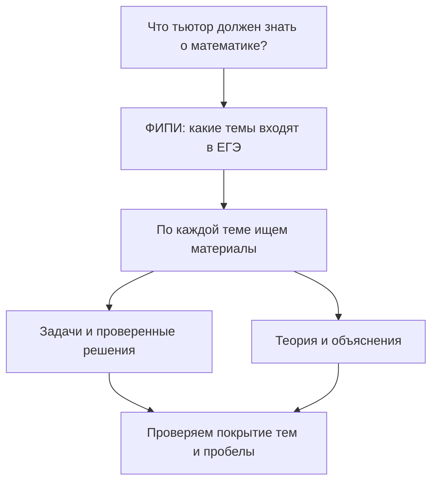

# EDA: план и точка продолжения

Обновлено: 23 октября 2026 года. Чекпойнт 2 — анализ данных; срок в годовом плане: 27 октября 2026, 23:59 (помечен как ориентировочный).

## Где мы сейчас

**Этап 01: знакомство выполнено, официальные темы и предметные требования перенесены в отдельные карты со схемами.** Пользователь ранее прочитал обзор ФИПИ; новые карты подготовлены к его просмотру.

**Этапы 02–03: собран пробный вариант «Решу ЕГЭ» из 19 задач.** [Проверка источника](02-sources/sdamgia-check.md) и [состав, качество и статистики набора](03-dataset/sdamgia-90702516.md). По переданному пользователем сообщению, банк ФИПИ на профилактике 22–27 октября. Происхождение альтернативного варианта не сверено с официальным PDF. Собственные теги, привязки к ФИПИ, шаги и KC не размечены; следующий шаг — согласовать правила разметки на сохранённых задачах. Просмотр пользователем новых карт этапа 01 пока не подтверждён.

| Этап | Статус | Где подробности |
|---|---|---|
| 01. Экзамен и официальная карта | Карты готовы к просмотру; обзор ранее прочитан | [README этапа](01-exam/README.md) |
| 02. Источники | Проверен один вариант «Решу ЕГЭ»; банк ФИПИ отложен | [README этапа](02-sources/README.md) |
| 03. Набор данных | Пробный набор: 19 задач, исходные материалы и технические статистики | [README этапа](03-dataset/README.md) |
| 04. Разметка | Не начата | [README этапа](04-annotation/README.md) |
| 05. Анализ и выводы | Первые технические статистики в этапе 03; предметный анализ не начат | [README этапа](05-analysis/README.md) |

## Как устроены документы

Три уровня: **этот README — маршрут и краткий статус → README этапа — цель, прогресс и продолжение → отдельные материалы — проверяемые результаты**.

После работы обновляем README соответствующего этапа: что сделано, что узнали, открытые вопросы, место остановки и следующее конкретное действие. Здесь обновляем только сводный статус. Подробности и результаты не копируем между уровнями.

Прочитанный пользователем [обзор ФИПИ](01-exam/fipi-overview.md) перенесён без содержательных изменений; исправлены только пути к изображениям. Проверка пользователем относится к этой версии текста. При дальнейших содержательных изменениях явно отмечаем, какие разделы изменены и требуют повторного просмотра. Наличие плана или ссылки на будущий результат не означает готовность результата.

## Цель этапа

Ответить на вопрос: **что система должна знать о всей программе профильного ЕГЭ по математике, чтобы тренировать ученика?**

Изучаем экзамен, реальные задачи и учебные материалы; строим предварительную предметную модель и проверяем её на собранном наборе. Охват — вся программа профильного ЕГЭ по математике. Изучаем все разделы и типы заданий экзамена; объём набора и детализацию разметки определяем после знакомства с материалами. Фиксируем покрытие и пробелы по всей программе.

Основание — [видение проекта](../project-vision.md). Годовые сроки находятся в [плане проекта](../project-plan.md).

## Как этот шаг связан с проектом

Вопрос: **что тьютор должен знать о математике, чтобы готовить ученика ко всей программе профильного ЕГЭ?** Официальный перечень ФИПИ задаёт основу для поиска материалов и проверки покрытия.

Связь этапов: [01 — официальная карта](01-exam/README.md) → [02 — поиск и проверка источников](02-sources/README.md) → [03 — сбор набора](03-dataset/README.md). ФИПИ — начальный источник заданий и требований; конкретные дополнительные источники решений, теории и объяснений ещё предстоит выбрать и проверить. По каждой теме затем сможем увидеть наличие задач, решений и объяснений и обнаружить пробелы.

**Текущая точка на 23 октября 2026 года:** получен один пробный вариант из 19 задач; результаты — в этапе 03. Разметку отдельно согласуем; статистики навыков и покрытие программы пока не считаем.

## Краткий маршрут и логика

Пометка от 21 октября 2026 года. Охват — вся профильная математика ЕГЭ.

Карта экзамена по ФИПИ → проверка источников задач, решений и теории → пробный набор по всем разделам → проверенная разметка «задача → шаг → навык» → EDA в Python → данные, `EDA.ipynb` и PDF о практической пользе.

Логика: карта задаёт основу для оценки покрытия; проверка источников показывает доступность и пригодность материалов; пробный набор помогает выбрать структуру данных до массового сбора; разметка связывает задачи с диагностикой навыков; EDA выявляет пробелы и обосновывает возможности тьютора.

**Начинаем с карты всего экзамена и проверки источников.** Это порядок дальнейшей работы, а не отчёт о выполнении.

### Как от тем приходим к навыкам

**Официальная карта ФИПИ → задачи по темам → проверенные решения → содержательные шаги → навыки → связи задач с навыками.**

Тема ФИПИ и навык — разные сущности: одна тема может требовать нескольких навыков, а один навык встречается в разных темах. Навыки выделяем позже из решений; сейчас сохраняем классификацию ФИПИ как есть. Подробности — в [этапе разметки](04-annotation/README.md).

## Что считаем данными

| Объект | Что фиксируем и зачем |
|---|---|
| Экзаменационные материалы | Версия экзамена, требования, содержание и форматы заданий — для определения границ |
| Задачи и эталонные решения | Источник, тема, формат ответа, проверенное решение и шаги — для практики и проверки |
| Разметка навыков | Связи шагов с KC, канонические названия и кандидаты на методы — для предметной модели |
| Учебные объяснения | Источник, покрываемые темы и навыки — для будущих объяснений и RAG |

Карта навыков — знания системы о предметной области. Индивидуальный профиль ученика требует его попыток; при отсутствии таких данных не делаем выводов о реальном освоении навыков.

## Последовательность работы

| Шаг | Что делаем | Результат |
|---|---|---|
| 1. Разобраться в экзамене | Открыть материалы ФИПИ, посмотреть задания всех разделов экзамена и попробовать решить примеры разных типов; изучить требования и форматы ответов | Карта содержания всего экзамена, типов заданий и предварительный план покрытия набора |
| 2. Собрать материалы | Составить каталог источников; собрать задачи, решения и объяснения; проверить происхождение и доступность | Исходный набор с прослеживаемыми источниками |
| 3. Разметить шаги и KC | Разобрать решения на содержательные действия, выделить KC и нормализовать названия; проверить корректность | Связи «задача → шаг → KC» и кандидаты на методы |
| 4. Провести анализ в Python | Исследовать состав и качество набора; после разметки считать частоты KC, совместную встречаемость и покрытие | Визуализации и выводы в `EDA.ipynb` |
| 5. Сделать выводы для тьютора | Определить доступные методы, проверяемые шаги, пробелы и ограничения; объяснить практическую ценность | Предварительная предметная модель и обоснование возможностей первой версии |

Первый этап ниже раскрыт в папке 01; сбор материалов разделён на поиск источников (02) и сбор набора (03); разметка находится в 04; анализ и выводы — в 05. Исходная логика плана сохранена.

Оговорки о частотах и совместной встречаемости перенесены в [этап разметки](04-annotation/README.md#ограничения-интерпретации).

## Результаты чекпойнта

По предоставленному сообщению организаторов: изучить особенности данных, признаки объектов и их взаимодействие, построить необходимые визуализации и сделать подробные выводы; отдельно объяснить практическую ценность.

Планируемые результаты:

- каталог источников и собранный набор задач, решений и объяснений;
- разметка шагов и KC, предварительная предметная модель;
- `EDA.ipynb` с анализом на Python, визуализациями и выводами — в GitHub;
- PDF о практической ценности проекта примерно на одну страницу — в GitHub.

В PDF объясняем, кому и в какой ситуации помогает тьютор, какую пользу даёт практика с диагностикой и что ограничивает предлагаемое решение. Эти результаты ещё предстоит подготовить; данный документ является планом, а не выполненным EDA.

Проектирование профиля ученика, педагогических действий и сессий продолжаем отдельно в [вопросах проектирования](../tutor-design-questions.md).

