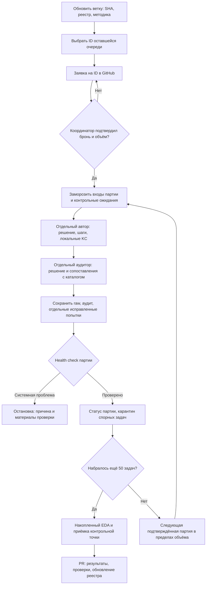

# Продолжение ФИПИ командой

Подготовлено 4 ноября 2026 года. Рабочая ветка — `docs/full-ege-math-scope`. Это инструкция передачи; заявки в GitHub ещё не опубликованы. **Готовы 100 разборов. Генерация следующих задач остановлена.** Подготовленная очередь не является разрешением запуска.

## Восстановить контекст за пять минут

Для общего просмотра чекпойнта: [предварительный единый EDA.ipynb](../../notebooks/checkpoint-2/EDA.ipynb) и [предварительный PDF о практической ценности](../../output/pdf/checkpoint-2-practical-value.pdf). Это отдельное представление сохранённых данных; raw, ID, реестр бронирования и правила командной разметки не меняются. [Следующее исследование связей](05-analysis/data-to-tutor-protocol.md) пока только описано, оно не разрешает генерации задач.

1. **Зачем (минута):** строим предварительную карту математических действий для тьютора по всему профильному ЕГЭ. Условие → решение → содержательные шаги → кандидаты навыков → проверенные соответствия каталогу → EDA. Частоты нужны, чтобы увидеть повторяющиеся действия и пробелы карты; освоение ученика по ним не измеряется.
2. **Что уже получилось (минута):** открой [итог 50→100](05-analysis/fipi-100-checkpoint.md). Банк: 1148 условий; разобрано 100, основные частоты по 98. Каталог предварительный, у большинства новых задач сопоставление неполное. В [HTML-отчёте](../../data/annotation/runs/2026-11-02-fipi-extension-150/derived/checkpoint-100-v1/index.html) сводные показатели на 100, карточки — только для новых 50; старые материалы доступны из строки «Первые 50» ниже.
3. **Какие понятия используем (минута):** прочитай следующий раздел с примером KC. Важно отличить исходную метку ФИПИ от навыка, предложенного агентом, и от принятого назначения в каталоге.
4. **Как продолжать (минута):** посмотри схему и раздел бронирования. Сначала актуальная ветка и подтверждённые ID, затем отдельные автор и аудитор, health check после партии, накопленный EDA каждые 50 новых. Само подключение к репозиторию ничего не запускает.
5. **Что дать своему агенту (минута):** [стартовое задание агенту](team-agent-start.md). Там перечислены обязательные входы, выходы, место сохранения EDA и остановка. Если нужна только аналитика сохранённых данных, так и укажи: её можно делать без новых решений и брони на разбор.

## Словарь на одном примере

**KC — Knowledge Component**, в нашей работе кандидат на переиспользуемое математическое умение, описанное через действие, объект, существенные условия и результат. Граница KC — гипотеза: похожее название ещё не означает одно и то же умение.

Учебный пример (не новая разметка корпуса): в решении текстовой задачи составили `3x + 2 = 14`, затем получили `x = 4` и проверили ответ по смыслу. Здесь различаются:

| Сущность | Что означает |
|---|---|
| Метка КЭС | Тематическая классификация источника; не назначается по этому придуманному примеру |
| Метод | Маршрут: составить уравнение → решить → проверить по смыслу |
| Шаг | Конкретное выполненное действие: из `3x + 2 = 14` получить `x = 4` |
| Локальный кандидат KC | Предложенное автором умение «решить линейное уравнение с числовыми коэффициентами» с ID, действующим только внутри этого разбора |
| Узел каталога KC | Замороженное определение с постоянным ID; аудитор сравнивает с ним действие по смыслу и свидетельствам |
| Назначение | Сохранённая связь конкретного локального кандидата с узлом каталога, если аудитор подтвердил полное соответствие |

«Составить и решить уравнение, затем проверить корень» может оказаться составным кандидатом: аудитор отмечает `needs_split`, не приравнивает весь маршрут к одному узкому умению. Новые кандидаты не становятся узлами автоматически. Ответы агентов и согласие между ними не являются экспертным эталоном.

## Откуда взялась текущая методика

Для продолжения не нужно перечитывать всю историю. Порядок происхождения и точные основания такие:

| Решение | Где прочитать основание |
|---|---|
| Использовали исходный промпт A, затем адаптацию для EDA-50 | [Пилот промптов](04-annotation/02.1-primary-prompting-analysis.md), [первые 50 и их фактическая процедура](../../data/annotation/runs/2026-10-31-fipi-50x1/README.md) |
| Исследовали границы KC, старый репозиторий и подходы из работ | [Исследовательский итог](../../research/2026-10-27-kc-investigation/README.md), [читаемое резюме](04-annotation/11-readable-research-summary.md). Это источники гипотез, а не альтернативные действующие инструкции |
| Понадобились определения, свидетельства и контекст предыдущих шагов | [Опыт входного состояния и переноса](../../research/2026-10-27-map-context-transfer/README.md) |
| Перешли к независимому сопоставлению и случайному расширению | [Зафиксированная методика и схема](04-annotation/12-expansion-50-to-200.md), [роль аудитора](04-annotation/12-kc-auditor-prompt.md) |
| Проверили процедуру на следующих 50 и сохранили ограничения | [Фактический запуск и обвязка v1.1](../../data/annotation/runs/2026-11-02-fipi-extension-150/README.md), [итог EDA-100](05-analysis/fipi-100-checkpoint.md) |

Для цитирования результата указывать путь документа, commit SHA и ID задачи; для числа на графике — также слой, исключения и знаменатель из `summary.json`. Для воспроизведения — manifest и сохранённую версию кода. Не ссылаться на эту переписку как на единственный источник правил.

## Что исследуем и что уже есть

ФИПИ — Федеральный институт педагогических измерений. Его открытый банк содержит задания с условиями и тематическими метками. У математики есть базовый и профильный уровни; в этом корпусе собран **только профильный**. Начальная навигация — [обзор ФИПИ](01-exam/fipi-overview.md); буквальный адрес проекта собранного банка — `https://ege.fipi.ru/bank/index.php?proj=AC437B34557F88EA4115D2F374B0A07B`. Год экзамена отдельных задач не установлен.

| Слой | Материалы и назначение |
|---|---|
| Снимок банка | [README банка](../../data/fipi/2026-10-31-profile/README.md): 1148 условий, 115 страниц, 443 PNG/GIF, 4067 фрагментов MathML. Исходный HTML, JSONL, JSON по ID, изображения, хеши и журнал сбора |
| Первые 50 | [Исходный пилот](../../data/annotation/runs/2026-10-31-fipi-50x1/README.md): выборка охвата, разборы в общем контексте, редакторские сопоставления KC |
| Следующие 50 | [Запуск расширения](../../data/annotation/runs/2026-11-02-fipi-extension-150/README.md): случайная очередь, отдельный автор и отдельный аудитор на каждую задачу, партии 15+15+15+5 |
| Результат на 100 | [Читаемый итог](05-analysis/fipi-100-checkpoint.md), [HTML](../../data/annotation/runs/2026-11-02-fipi-extension-150/derived/checkpoint-100-v1/index.html), [исполненный ноутбук](../../data/annotation/runs/2026-11-02-fipi-extension-150/derived/checkpoint-100-v1/review.ipynb) |
| Состояние всех ID | [Машиночитаемый реестр](../../data/annotation/team/registry.json), [правила полей и брони](../../data/annotation/team/README.md) |

Сбор выполнен `scripts/collect_fipi_bank.py` через curl, привязанный к Wi-Fi при включённом VPN, с проверками между партиями. Маршруты и VPN глобально не менялись. Конкретный IP интерфейса прежней машины переносить на другую нельзя. Повторно скачивать корпус для продолжения разбора не требуется. Ответов и официальных решений в снимке нет: сохранённые разборы созданы агентами. Дефект исходника `697AC9` сохранён и исключён из очереди.

### Если всё-таки нужен новый доступ к сайту: опыт с VPN

Во время исходного сбора пользователь наблюдал: без VPN сайт открывался, с VPN — не загружался. На этой машине сработал запрос curl через Wi-Fi с `--noproxy "*"`, `--interface` и `--resolve ege.fipi.ru:443:...`. Это привязка конкретных запросов к интерфейсу и адресу назначения; отдельный VPN-туннель мы не разворачивали. Обход прокси сам по себе не отключает системный VPN.

Исторические значения: Wi-Fi `192.168.1.2`, сервер `80.250.169.3`; это **наблюдения запуска 31 октября, не проверенные адреса для новой машины или сегодняшней сети**. [README сбора с командой и ограничениями](../../data/fipi/2026-10-31-profile/README.md), [реализация curl и параметры](../../scripts/collect_fipi_bank.py).

Если обновление источника действительно поручено: сначала согласовать операцию и ID/страницы, определить текущий IPv4 физического интерфейса и адрес сервера, сохранить один пробный GET в новый каталог, проверить, что это нужная страница с читаемыми задачами, а не заглушка или ошибка. Затем небольшая партия и контроль изображений/MathML. Если привязка не работает при маршрутизации нового VPN, зафиксировать ошибку и отдельно решить сетевой доступ; прежний успех не гарантирует переносимость. Глобально отключать VPN или менять маршруты ради повторения не требуется текущим протоколом. Старый снимок не перезаписывать; новый сбор — отдельная датированная версия со своими URL, временем и SHA. Полная история режимов сбора и проверок уже сохранена в README и журнале банка.

Поля источника: регистрозависимый `id`, URL, страница и её SHA, исходный и производный HTML условия, инструкция, список меток КЭС, тип ответа, ссылки на assets, число MathML и дефекты. Первая метка КЭС — первая в записи банка, а не установленная главная тема. КЭС, локальный KC и метод решения — разные сущности.

## Приоритет 1: общая методика и распределение

1. Обновить локальную копию `docs/full-ege-math-scope`, записать полный SHA полученного коммита. При незакоммиченных изменениях сначала сохранить их; не применять `reset --hard`. Прочитать этот документ, последние статусы AGENTS.md и итог EDA-100.
2. Прочитать `registry.json` и очередь `selection.json`. Из 150 новых запланированных ID первые 50 выполнены; порядковые номера 51–150 — оставшиеся 100. Другие свободные ID банка вне этой очереди в текущую серию не включать. Состав очереди не перевыбирать.
3. Проверить актуальные GitHub Issues, включая заявки, ещё ожидающие подтверждения. Создать заявку по шаблону «ФИПИ: бронирование партии» с точными ID, версией методики и исходным SHA. Это внешнее действие выполняет участник после публикации комплекта; агент пишет от его имени только при соответствующем поручении.
4. Координатор последовательно проверяет пересечения и явно подтверждает ID, объём и остановку комментарием `reserved`. При конфликте первая заявка не считается автоматически победившей: решение фиксирует координатор. Самостоятельный статус участника и локальная проверка бронь не выдают. Не запускать парсинг/разбор до подтверждения. Сейчас ни одной такой брони нет.
5. Выполнить только подтверждённую партию по ролям ниже. После партии сохранить проверки и статус; при системной проблеме остановиться. Для остатка действуют группы 15+15+15+5 на каждые 50, затем EDA на 150 и 200 суммарно. Бронь на 15 не разрешает весь остаток. Не начинать следующий блок до приёмки контрольной точки координатором.
6. Передать PR с исходными результатами и проверками. После приёмки координатор обновляет общий реестр, фиксирует `accepted`. При отказе от работы явно освобождает оставшиеся ID (`released`); незавершённые материалы и причины сохраняются. Дата следующего статуса не является автоматическим истечением брони.

Бронирование — организационный протокол с одним координатором, а не автоматическая распределённая блокировка. GitHub Issues дают общую видимость; JSON в Git — офлайн-снимок, который может отставать. Шаблон расположен в .github/ISSUE_TEMPLATE/fipi-batch.md; список реальных броней появляется после создания и подтверждения заявок.

## Что именно передавать агентам

Версия продолжения — `fipi-extension-v1.1`. Точные файлы и их SHA перечислены в `methodology_sha256` реестра. Схема и мотивировка — [методика расширения](04-annotation/12-expansion-50-to-200.md), роль и критерии — [промпт аудитора](04-annotation/12-kc-auditor-prompt.md). Фактические замороженные инструкции находятся в [каталоге запуска](../../data/annotation/runs/2026-11-02-fipi-extension-150/README.md).

| Роль | Вход | Выход и границы |
|---|---|---|
| Координатор | Подтверждённые ID, условия, очередь и методика | Фиксирует партию, входы, исходные ожидания для выборочной проверки до просмотра ответов; не назначает KC вместо аудитора |
| Автор | `author-prompt.txt` + `author-wrapper.txt`, `requests/author/ID.txt`, все указанные исходные изображения | Один свежий контекст на задачу. Самостоятельное решение, методы, шаги, локальные кандидаты KC в установленной JSON-схеме. Без каталога, старых разборов и ответов других агентов |
| Аудитор | `auditor-prompt.txt` + `audit-format-wrapper-v1.1.txt`, исходное условие/изображения, сохранённый ответ автора, `catalog-for-auditor.json`, список допустимых ссылок | Другой свежий контекст. Проверка входа/решения и каждого кандидата: `match`, `new_candidate`, `needs_split`, `uncertain`; буквальные свидетельства, замечания и блокировки. Не получает ожидаемых назначений координатора |
| Проверяющий партии | Исходники, результаты и журналы | Техническая валидность, выборочный просмотр картинки/формул и независимые расчёты, решение продолжать / карантин / остановка |

Развёрнутый `request` сохраняется буквально; его наличие не доказывает исполнение. Журналировать фактическое сообщение запуска, механизм изоляции, модель и настройки если доступны (иначе `unknown`), время UTC, входные SHA, исходный ответ и результаты проверок. Другая модель или среда отмечается отдельным слоем анализа; одинаковые промпты не гарантируют одинаковый результат. Общий чат автора и аудитора не соответствует этой серии.

## Как сохранять продолжение

Для новой командной партии создать отдельный каталог `data/annotation/runs/<дата>-fipi-team-<участник>-<партия>/`. Сохранить `README.md`, `manifest.json` (issue, ID, базовый SHA, версия методики, SHA входов), `requests/`, `raw/author/`, `raw/auditor/`, `executions/`, `validations/`, `checks/`, `attempts/`, `active-attempts.json` и `environment.json`. Референс структуры — завершённый запуск. Данные задач брать из сохранённого банка, изображения копировать с проверкой SHA; инструкции и каталог копировать побитово.

Существующие скрипты расширения привязаны к историческому каталогу запуска. **Не запускать их генерацию отчёта или подготовку как универсальную команду для нового каталога.** До новой командной партии адаптировать пути отдельно, сохранить версию кода и проверить совместимость схем; это задача подготовки конкретной партии, не повод менять прошлые результаты. В этом комплекте реализованы инвентаризация и проверка заявки, универсального исполнителя партий пока нет. Новые запросы к моделям через эти команды не выполняются.

Исходный ответ не перезаписывать. Исправление — отдельная попытка с причиной и ссылкой на обратную связь, выбор активной версии фиксировать явно. Технический сбой, незавершённость, спорное решение и блокировка аудита — разные состояния. Новые предложения KC остаются локальными; координатор не объединяет их по похожим названиям. Изменения промпта, определения KC или порога аудита оформлять отдельной версией и обсуждать до применения к серии.

## Health checks и EDA

EDA выполняет агент-аналитик из **сохранённых** результатов через Python, после технических проверок и независимого аудита. Для аналитики не нужно решать задачи повторно или генерировать недостающие связи. Если его среда не исполняет код или не показывает картинки, он фиксирует ограничение и незавершённую проверку, а не ставит отметку об успешном просмотре.

После каждой партии: полные пары автор–аудитор, валидные схемы/ID/ссылки/цитаты, покрытие всех локальных кандидатов аудитом, доступность всех assets, браузерная отрисовка условий и выборочный просмотр минимум трёх карточек с изображениями/MathML при наличии. Контрольные ID и математические ожидания фиксировать до просмотра ответов; проверки, сделанные позже, обозначать как проверки после просмотра. При дефекте чтения изображения — новая попытка с происхождением; при блокировке — карантин, а не ручная отмена вердикта.

В EDA отдельно показывать исторический и новый слои, затем накопленный корпус:

- Состав: число задач, типы ответа, метки КЭС, изображения/MathML, близкие шаблоны; первая выборка охвата и случайный остаток имеют разные правила отбора.
- Готовность: авторские ответы, полные пары, исправленные попытки, блокировки, исключения и точный знаменатель каждого расчёта.
- Структура: шаги, локальные KC и методы на задачу, медианы по типам ответа.
- Каталог: принятые связи, наблюдаемые узлы фиксированного каталога, единичные узлы и частоты по задачам; доля несопоставленных кандидатов и задач с неполным сопоставлением.
- Аудит: четыре статуса по локальным кандидатам. Число новых предложений не равно числу новых уникальных навыков.
- Совместная встречаемость KC по задачам и переходы между соседними шагами внутри одного метода, с устранением повторного счёта в задаче; переходы не означают prerequisites.

Эталон определения метрик — код и сохранённые артефакты `checkpoint-100-v1`. Исторический каталог содержит 144 определения; наблюдаемые 138 узлов и снижение единичности 74%→55% не доказывают правильность каталога. Из 100 задач в основных частотах 98 (`eFF32e`, `C41083` исключены); это не accuracy. 45/49 новых задач имеют неполное сопоставление. Ошибка чтения `F416AF` исправлена отдельной попыткой, а порог блокировки вероятностной модели неодинаков — не скрывать эти ограничения при продолжении.

### Куда агент сохраняет свой EDA

В каталоге **своей** партии создать `derived/eda-v1/`: `report.md` (выводы и сравнение), `summary.json` (числа, знаменатели, исключения), исполненный `review.ipynb`, `figures/`, `tables/`, `index.html` со ссылками на карточки и `provenance.json` со списком входов, SHA, версии методики и кода. Если обновляет отчёт — `eda-v2`, не перезапись принятой версии. Локальная аналитика по 15 задачам обозначается «отчёт партии», а не EDA-150.

Для накопленного EDA-150/200 координатор собирает явный список принятых партий и активных попыток без повторов ID. Агент-аналитик сохраняет накопленную контрольную точку в **отдельном новом каталоге анализа**, например `data/annotation/analyses/<дата>-fipi-checkpoint-150-v1/`, с тем же комплектом выходов и manifest всех входящих партий. Исторические 50/100 и отчёты участников остаются неизменными. Расчёт не должен просто суммировать готовые частоты партий: для единичности и совместной встречаемости нужны записи по ID задач.

В `report.md` обязательно ответить: что добавилось; что изменилось относительно EDA-100 по тем же определениям; какие изменения могут объясняться составом выборки, моделью или процедурой; какие ошибки/спорные случаи нашли; какие выводы пока невозможны. Добавить сводку по всему накопленному корпусу и отдельные слои происхождения. Сохранять HTML-ссылки на карточки всех включённых партий, чтобы сводка не выглядела как отчёт только о новых задачах. `provenance.json` отличает реально исполненный ноутбук от подготовленного. Реализацию переноса путей исторических скриптов и проверки метрик сначала проверять на сохранённой контрольной точке, без новых модельных запросов.

## Приоритет 2: проверка подключения

После подготовки распределения воспроизвести сохранённый EDA без модели и сети по [инструкции запуска](../../data/annotation/runs/2026-11-02-fipi-extension-150/README.md). Проверить локальную Python/Jupyter-среду. Затем согласовать малую калибровку по [сохранённым пяти случаям](../../data/annotation/runs/2026-11-02-fipi-extension-150/calibration/README.md), сохраняя новые ответы отдельно; не выдавать исторические агентные вердикты за эталон. Калибровка требует отдельного объёма запуска и не начинает оставшуюся сотню автоматически.

## Короткий текст для команды

> Подготовлен снимок профильного банка ФИПИ (1148 условий) и первые 100 разборов с EDA. Начните с `docs/eda/team-handoff.md` в актуальной `docs/full-ege-math-scope`, запишите SHA. Там есть реестр готовых задач, очередь, точные инструкции автора и независимого аудитора, проверки и метрики. До работы создайте заявку с точными ID и дождитесь подтверждения координатора; не скачивайте банк заново и не меняйте общий каталог в своей партии. Сейчас продолжение остановлено на 100, объём следующей партии назначается явно.

Текст подготовлен для ручной отправки; сообщения команде не отправлялись.
