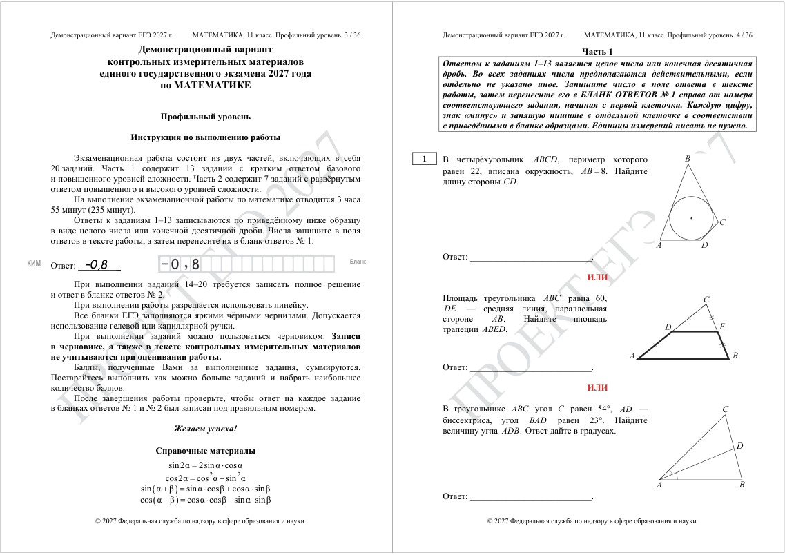
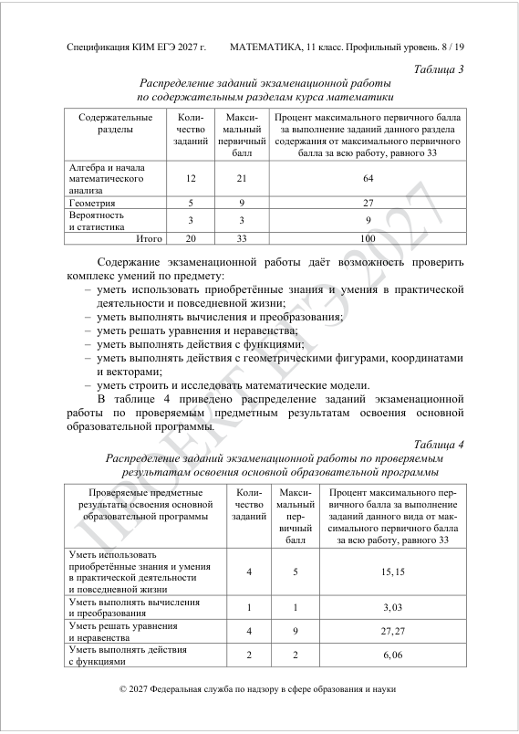
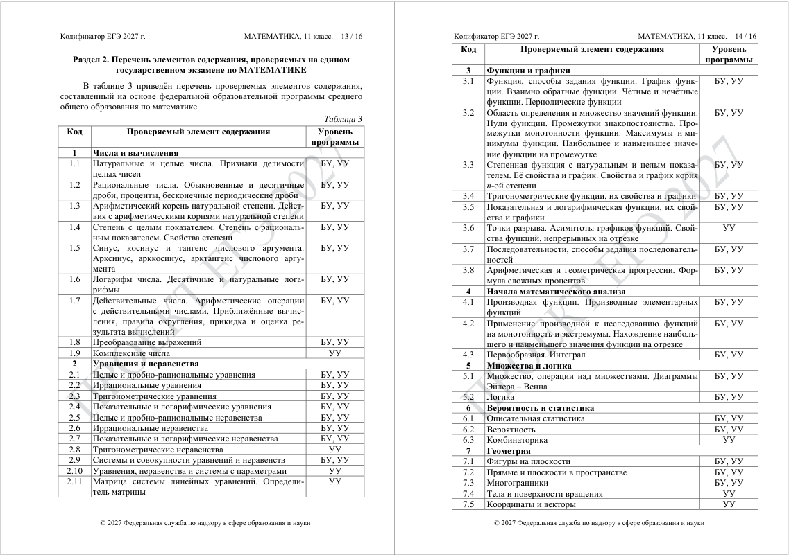
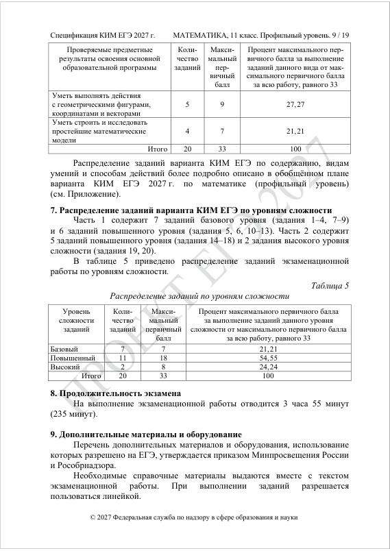
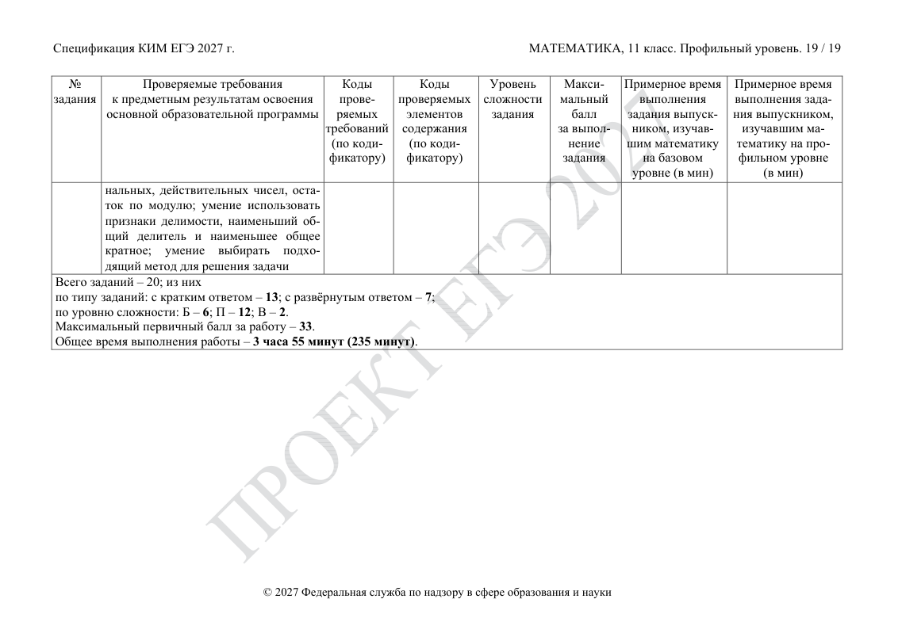

# ФИПИ: первое знакомство с профильной математикой ЕГЭ

Проверено 21 октября 2026 года. Охват проекта — вся профильная математика ЕГЭ. Это обзор официальных документов для обсуждения, без собственной классификации и дробления на навыки.

## 1. Откуда берём информацию

ФИПИ — Федеральный институт педагогических измерений. В скачанных документах он указан как разработчик комплекта. Идём к нему, чтобы узнать содержание, устройство и оценивание экзамена из первоисточника. КИМ — контрольные измерительные материалы, то есть экзаменационные задания стандартизированной формы (спецификация: PDF 1, печатная с. 2).

- [Страница ФИПИ с комплектами по предметам и годам](https://fipi.ru/ege/demoversii-specifikacii-kodifikatory).
- [Официальный ZIP по математике, 2027](https://doc.fipi.ru/ege/demoversii-specifikacii-kodifikatory/2027/ma_11_2027.zip).
- [Открытый банк заданий ЕГЭ](https://fipi.ru/ege/otkrytyy-bank-zadaniy-ege) — следующий источник для знакомства с разнообразием задач; в рамках этого отчёта банк не разобран.

На странице ФИПИ комплект 2027 года обозначен как проект; на титульных страницах трёх изученных документов также стоит «ПРОЕКТ». Описываем именно эту редакцию, без предположения о её окончательном утверждении.

### Что лежит в ZIP

| Имя файла в архиве | Страниц PDF | Что делали |
|---|---:|---|
| МА-11 ЕГЭ 2027 ДЕМО_профильный.pdf | 18 | Прочитан и просмотрен |
| МА-11 ЕГЭ 2027 СПЕЦ_профильный.pdf | 14 | Прочитан и просмотрен, включая приложение |
| МА-11 ЕГЭ 2027_КОДИФ.pdf | 8 | Прочитан и просмотрен |
| МА-11 ЕГЭ 2027 ДЕМО_базовый.pdf | 17 | Учтён в составе архива, содержательно не разбирался |
| МА-11 ЕГЭ 2027 СПЕЦ_базовый.pdf | 6 | Учтён в составе архива, содержательно не разбирался |

**Как проверять страницы:** «PDF 7» означает седьмую страницу файла в просмотрщике; «печатная с. 13» — номер в шапке самого документа. Демоверсия и кодификатор свёрстаны разворотами: одна страница PDF содержит две печатные. У спецификации PDF 1–5 содержат печатные с. 1–10, PDF 6 — с. 11, PDF 7–14 — с. 12–19.

Для открытия отдельных файлов без распаковки есть сторонние копии: [демоверсия](https://examlab.ru/fipi/ege-2027-matematika-profil-demo.pdf), [страница с тремя документами](https://examlab.ru/demo/ege-2027-matematika). Основание отчёта — скачанный официальный ZIP; совпадение сторонних копий по байтам в этом отчёте не проверялось.

## 2. Демоверсия: как выглядят задачи

Демоверсия показывает пример устройства работы. Она не исчерпывает всё содержание и все возможные формулировки. Для некоторых номеров даны альтернативные примеры через «ИЛИ»; в реальном варианте на каждой позиции будет одно задание (PDF 1, печатная с. 2).

| Что открыть | Где в демоверсии |
|---|---|
| Назначение демоверсии и оговорки о примерах | PDF 1, печатная с. 2 |
| Инструкция: время, части, формат ответа, справочные формулы | PDF 2, печатная с. 3 |
| Часть 1: номера 1–13 | PDF 2–7, печатные с. 4–13 |
| Часть 2: номера 14–20 | PDF 7–8, печатные с. 14–16 |
| Таблица эталонных ответов к части 1 | PDF 9, печатная с. 17 |
| Решения и критерии части 2 | PDF 9–18, печатные с. 18–36 |

Ниже — краткое описание показанных примеров, а не новая классификация заданий или официальные названия типов.

| № | Что можно увидеть в примерах | Где: PDF / печатная с. |
|---:|---|---|
| 1 | Окружность в четырёхугольнике; средняя линия треугольника; углы и биссектриса | 2 / 4 |
| 2 | Координаты, длина и скалярное произведение векторов; есть рисунок | 3 / 5 |
| 3 | Призма, параллелепипед, цилиндр и шар; есть пространственные рисунки | 3–4 / 5–6 |
| 4 | Вероятности в сюжетах о билетах, пассажирах и жребии | 4 / 6 |
| 5 | Сочетания событий: попадания, контроль батареек, масса хлеба | 4 / 7 |
| 6 | Математическое ожидание выигрыша по таблице | 4 / 7 |
| 7 | Показательное, иррациональное, логарифмическое уравнения | 4 / 8 |
| 8 | Преобразования тригонометрических, логарифмических и степенных выражений | 4 / 8 |
| 9 | Графики функции или производной, касательная | 5 / 9 |
| 10 | Вычисления по формулам в физических сюжетах | 5 / 10 |
| 11 | Движение, смеси, совместная работа | 6 / 11 |
| 12 | Определение значений по графикам функций | 6 / 11–12 |
| 13 | Кредит с равными платежами | 7 / 13 |
| 14 | Тригонометрическое уравнение и отбор корней | 7 / 14 |
| 15 | Доказательство и вычисление в пространственной геометрии | 7 / 14 |
| 16 | Логарифмическое или показательное неравенство | 7 / 14 |
| 17 | Поиск максимума мощности или амплитуды в прикладной модели | 8 / 15 |
| 18 | Доказательство и вычисление в плоской геометрии | 8 / 15 |
| 19 | Значения параметра при заданном количестве решений | 8 / 16 |
| 20 | Задачи о целых числах: карточки или монеты, несколько подпунктов | 8 / 16 |

Для № 1–5 и 7–12 дано по три примера, для № 6 и 13 — по одному, для № 14–20 — по два. Это 20 позиций с альтернативными примерами, а не 49 обязательных заданий одной работы. Проверка: условия на печатных с. 4–16 и таблица ответов на с. 17.

## 3. Спецификация: как устроен экзамен

Спецификация описывает модель экзамена. Её собственная структура: назначение КИМ; документы-основания; соответствие школьной программе; подходы к отбору содержания; структура работы; распределения по содержанию, результатам и сложности; время; оборудование; оценивание; изменения к предыдущему году; приложение с обобщённым планом.

| Параметр | Что указано | Где в спецификации |
|---|---|---|
| Всего | 20 заданий, две части | PDF 3, печатная с. 6; PDF 4, с. 7 |
| Часть 1 | № 1–13, краткий ответ: целое число или конечная десятичная дробь; по 1 первичному баллу | PDF 3–4, с. 6–7; PDF 5, с. 10 |
| Часть 2 | № 14–20, полное решение с обоснованием и ответ | PDF 3–4, с. 6–7 |
| Баллы части 2 | № 14, 16, 17 — по 2; № 15, 18 — по 3; № 19, 20 — по 4 | PDF 5, с. 10 |
| Максимум | 33 первичных балла: 13 за часть 1 и 20 за часть 2 | PDF 4, с. 7; PDF 6, с. 11 |
| Итоговая шкала | Первичные баллы переводятся в тестовые по 100-балльной шкале; конкретная таблица перевода здесь не дана | PDF 6, с. 11 |
| Время | 235 минут (3 часа 55 минут) | PDF 5, с. 9 |
| Материалы | Разрешена линейка, необходимые справочные материалы выдаются с работой | PDF 5, с. 9 |

Для развёрнутых ответов допускаются разные математически корректные методы и формы записи. Оценивается продвижение в решении, а не совпадение с приведённым образцом (спецификация: PDF 3, печатная с. 6). В демоверсии отдельно указано: правильный ответ без текста решения для части 2 даёт 0 баллов (PDF 9, печатная с. 18).

### Распределение по содержанию — таблица ФИПИ

Официальные названия сохранены. Источник: спецификация, таблица 3, PDF 4, печатная с. 8.

| Содержательный раздел | Заданий | Максимальный первичный балл | Доля баллов, % |
|---|---:|---:|---:|
| Алгебра и начала математического анализа | 12 | 21 | 64 |
| Геометрия | 5 | 9 | 27 |
| Вероятность и статистика | 3 | 3 | 9 |
| Итого | 20 | 33 | 100 |

### Где искать характеристики конкретного номера

В приложении — обобщённый план (PDF 7–14, печатные с. 12–19). Колонки ФИПИ: номер; проверяемые требования; коды требований; коды элементов содержания; сложность; максимальный балл; примерное время для выпускника, изучавшего математику на базовом или профильном уровне.

Таблица 1 основной части (PDF 2, печатные с. 3–4) связывает задания со школьными программами. Это другая таблица: её ссылки на пункты программ нельзя смешивать с кодами кодификатора из приложения. В этом обзоре обе таблицы описаны, но полная построчная карта из них не создавалась.

## 4. Кодификатор: как он организован у ФИПИ

Кодификатор общий для математики: в комплекте один файл, без слова «профильный» в названии. В таблицах есть указания БУ/УУ — базового и углублённого уровней требований или программы. Не смешиваем их с Б/П/В — сложностью конкретного задания в спецификации.

| Раздел документа | Что внутри | Где в кодификаторе |
|---|---|---|
| 1. Перечень проверяемых требований к результатам освоения основной образовательной программы среднего общего образования по математике | Таблица 1: метапредметные результаты; таблица 2: предметные требования, уровень и связь с метапредметными результатами | PDF 2–6, печатные с. 3–12 |
| 2. Перечень элементов содержания, проверяемых на едином государственном экзамене по математике | Таблица 3: код, содержание, уровень программы | PDF 7, печатные с. 13–14 |
| 3. Отражение в содержании контрольных измерительных материалов личностных результатов освоения основной образовательной программы среднего общего образования | Описание личностных результатов | PDF 8, печатные с. 15–16 |

Перечень трёх разделов и основания документа: PDF 1, печатная с. 2. В таблице 2 предметные требования имеют коды 1–13. В таблице 3 используется отдельная система кодов содержания: 1–7 и подпункты. Например, код требования 4 и код содержания 4 — ссылки на разные таблицы.

### Верхний уровень содержания — ровно как у ФИПИ

Это группы внутри раздела 2 документа, не новая классификация проекта. Источник: таблица 3, PDF 7, печатные с. 13–14.

| Код | Название ФИПИ | Подпункты |
|---|---|---|
| 1 | Числа и вычисления | 1.1–1.9 |
| 2 | Уравнения и неравенства | 2.1–2.11 |
| 3 | Функции и графики | 3.1–3.8 |
| 4 | Начала математического анализа | 4.1–4.3 |
| 5 | Множества и логика | 5.1–5.2 |
| 6 | Вероятность и статистика | 6.1–6.3 |
| 7 | Геометрия | 7.1–7.5 |

## 5. Расхождения и ограничения источников

**В проекте спецификации есть внутреннее расхождение по сложности.** Раздел 7 и таблица 5 (PDF 5, печатная с. 9) дают 7 базовых, 11 повышенных и 2 высоких задания. Итог приложения (PDF 14, печатная с. 19) даёт Б — 6, П — 12, В — 2. Подсчёт обозначений в строках приложения даёт 7/11/2: № 1–4, 7–9 — Б; № 5–6, 10–18 — П; № 19–20 — В. Источник не исправлялся; окончательные агрегаты нужно сверить после обновления редакции.

- Демоверсия не гарантирует охват всех формулировок и содержания: это прямо оговорено на печатной с. 2.
- Общий кодификатор и план конкретного экзамена имеют разную детализацию. Наличие подпункта в общем списке само по себе не означает отдельный номер задания на него.
- Краткие описания примеров в разделе 2 отчёта — пересказ условий для навигации. Полные условия, рисунки и критерии проверяем по PDF. Математические решения заново не решались и не валидировались.
- Рисунки и таблицы в отчёте — изображения оригинальных страниц/половин страниц. Формулы не восстанавливались догадками из извлечённого текста.

## 6. Что выполнено и что обсуждать дальше

**Выполнено:** официальный ZIP скачан и успешно распакован; все 40 страниц PDF трёх основных документов просмотрены в обзорных листах; текст прочитан; опорные таблицы и расхождение дополнительно просмотрены отдельно. Условия всех 20 номеров учтены, альтернативные примеры отмечены. Это ознакомление с устройством документов, а не полный перенос таблиц или готовый учебный датасет.

**Для обсуждения:** понятны ли устройство экзамена и назначение трёх документов? Следующим действием можно перенести официальное содержание с сохранением кодов ФИПИ. Собственные навыки, новая классификация, сбор большого банка задач и разметка решений в этом отчёте не выполнялись.

### Проверяемая версия источников

SHA-256 скачанного ZIP: `6864e19e4004895b825faff81da3e1a2938b4faf1682ec67cdb9b70b8d4e0832`.

| Документ | SHA-256 |
|---|---|
| Демоверсия профильного уровня | `2b12d43cd00b03dfc9755140d6c78276fab8a9c0a3dff2f7483d60dc68711c8c` |
| Спецификация профильного уровня | `2e7adcaa799c5c06ff79aa55451b049d87cc8c4f4570d5fb150a5ea50a1e4f38` |
| Кодификатор | `1f6a8217fc7c0aae5e7958e2f0e3fa40e0556df431f11651680adcc2622e96b3` |

Хеши позволяют понять, не обновились ли файлы по тем же ссылкам. Изображения выше относятся именно к этой скачанной редакции.
