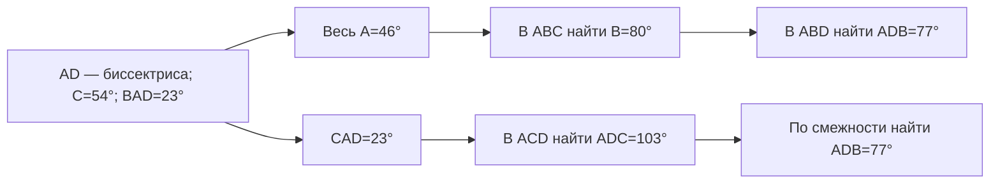

# Что три примера добавляют к карте

Это ручной разбор основного агента по [сохранённому снимку демоверсии-2027](../../docs/images/fipi-2027/demo-examples.png), позиция 1, печатная с. 4. Происхождение снимка описано в [прежнем обзоре](../../docs/eda/01-exam/fipi-overview.md). Это три альтернативы одной позиции, **не три новых задания из банка**. Условия, маршруты и черновые определения — в [geometry-audit.json](geometry-audit.json).

## От условия к математическому действию

| Пример | Что задано и требуется | Предлагаемое математическое основание | Что затем вычисляется |
|---|---|---|---|
| D27-1a | Четырёхугольник с вписанной окружностью, периметр 22, AB=8; найти CD | У описанного четырёхугольника суммы противоположных сторон равны | Полупериметр 11, затем CD=3 |
| D27-1b | Площадь ABC равна 60; DE — средняя линия параллельно AB; найти площадь ABED | Подобие CDE и CAB; отношение площадей равно квадрату отношения соответствующих длин | Малый треугольник: 15, трапеция: 45 |
| D27-1c | AD — внутренняя биссектриса, C=54°, BAD=23°; найти ADB | Биссектриса и сумма углов треугольника; в одном маршруте ещё смежность | Два маршрута дают ADB=77° |

Ответы здесь получены основным агентом, а не взяты из таблицы ФИПИ. [Проверка кодом](checks.json) сверяет арифметику и отдельную координатную иллюстрацию площадей; она не заменяет доказательств и экспертизы.

Во всех случаях нужно **выбрать математическое отношение по геометрическим условиям**, а затем выполнить вычисления. Восемь прежних карточек этого отношения не описывают. Нельзя автоматически назначить `lin_eq` по тому, что неизвестная длина в конце выражена числом: нужно увидеть именно решение уравнения в конкретной трассе. Если ученик непосредственно вычисляет разность, это другое наблюдение.

## Один ответ, два метода

Для D27-1c допустимы, например, такие последовательности:

Стрелки показывают **ход этих решений**, не универсальную зависимость освоения. В первом маршруте действие с суммой углов повторяется в разных треугольниках. Во втором оно выполняется один раз, затем используется смежность. Если требовать совпадения списков KC между любыми правильными решениями, будем штрафовать допустимый выбор метода. Поэтому сравнивать следует действие и его основание внутри конкретного маршрута; разнообразие методов учитывать отдельно от непоследовательности разметки.

## Пять черновых семейств, а не пять установленных KC

В JSON записаны отдельные предложения: равенство сумм противоположных сторон описанного четырёхугольника; отношение площадей подобных фигур; отношение частей угла при биссектрисе; третий угол треугольника; угол по смежному. Для каждого есть вход, продукт, предусловие, пример недопустимого расширения и открытая граница.

Например, для суммы углов важны **выбранный треугольник и внутренние углы**, а для смежности — противоположность лучей, а не просто общая сторона. Такие условия позволяют тьютору уточнить основание ответа: выбрана ли нужная фигура, установлено ли отношение, верно ли выполнено вычисление. Это предполагаемый сценарий, не проверенная диагностика ученика.

Все пять семейств предварительно адресованы к широкому `content:7.1` проекта кодификатора 2027. Это наша связь; ФИПИ не задаёт здесь эти пять названий и их атомарность. Подобие, распознавание средней линии и вычитание площадей ещё нельзя считать полностью описанными одной карточкой. Замороженная карта из восьми карточек не менялась.

**Практическое изменение процедуры:** хранить условие/рисунок → установленное отношение → вход следующего действия → наблюдаемое действие → результат. Похожая финальная формула не заменяет происхождения отношения. Отказ узкой карты на геометрии — повод явно записать пробел, а не растянуть определение алгебраического KC до всех задач.
